# 2.5D パペット・ステージ・お絵かきツール（Puppet チーム, v2.0）

SPEC §12.7（v2.0 は 2.5D）の製品版。スパイク（`docs/V2_25D_TECH.md`）のコードを製品モジュールに移し、`features/spike25d/` は削除した。
子どもの絵 → 自動リグ（骨入れ）→ 2D メッシュ＋スキン重み → 手続き型アニメ → `Canvas.drawVertices` で描画。Android 7〜9（Skia/GLES2）と iOS / Android 10+（Impeller）で同じコード。新しいパッケージ・権限・ネイティブコードは無し。

```
lib/features/
  puppet/          自動リグ・メッシュ・重み・リグ JSON・クリップ・描画ウィジェット・ジョイントエディタ
    rig/           bin_mask, skeleton, auto_rig, limb_hints（線・ストロークから腕を探す）, character_rig（JSON v2）
    mesh/          puppet_mesh（グリッドメッシュ・測地距離の LBS 重み・ステッカーのふち・シンプルな見た目）
    anim/          skinner（CPU の LBS）, clips（14 クリップ）
    render/        puppet_sprite（drawVertices + ImageShader）, puppet_view（ウィジェット）, aura（でんせつ）
    editor/        rig_edits（純粋な編集・undo）, joint_editor_screen, character_joints_page（ルート）
    puppet_builder.dart   Isolate でビルド＋メモリ上限つきキャッシュ, 品質ティア
    puppet_look.dart      見た目（かくし要素のシンプル / でんせつ）
    puppet_parts.dart     描いたパーツ → 追加の骨（docs/LOOP.md）
    puppet_store.dart     リグ JSON とストロークの保存（端末内）
    character_puppet.dart Character → PuppetSpec（統合用）
  battle_stage/    2.5D ステージ（カメラ・演出・背景テーマ・VFX）、エンジンとのアダプタ、オーバーレイ部品
    adapters/battle_v2_feed.dart   試作 v3 エンジン（domain/battle_v2）→ StageEvent
    debug/         /debug/25d（デモバトル・エディタ・お絵かきツール）
  draw_canvas/     アプリ内お絵かきツール（SPEC §12.2 入力②）と解析
```

## 0. まとめ（決定事項）

| 項目 | 決定 |
|---|---|
| リグ JSON | **v2**（短いキー、`v:2`）。**2 KB 以下**・骨 12 本以下・座標は絵の外 50 % まで・`attach` は自分より前の頭/腕/つの・未知の版や不正値は**捨てて自動リグに戻す**（`CharacterRig.tryDecode`）。v1（スパイク）も読める。最大構成で 2 KB 未満をテストで確認 |
| リグの保存先 | `PuppetStore`（`<documents>/puppet/<id>/rig.json`、`strokes.json`）。Engine v3 の Character v2 `rig`（不透明 JSON）が入ったら、統合時に `loadRigJson` をそこへ写す（§6）。おわかれ・全削除で消える |
| 精度改善 | 頭の取り違え（胴の円を頭にする）を直す・ばんざいの腕を髪と間違えない・腕を広げた人を動物と間違えない・横の「つの」を足りない腕に昇格・**絵の線で囲まれた細長い部分**（体にくっついた腕）を腕にする・少し離れた手を橋渡し・**お絵かきツールのストローク**で体に描いた腕を見つける（§2） |
| ジョイントエディタ | 誕生直後に「うごく ところを なおそう」（**あとで** で飛ばせる）、キャラ詳細の「うごく ところを なおす」からも。丸ハンドル（直径 52dp・当たり判定 44dp 半径）にアイコン（かお・て・あるく・しっぽ・ハート）、右上で**常に動くプレビュー**、もどす（undo 40 段）・さいしょ・＋て/＋あし/＋しっぽ・けす・できた！（§3） |
| お絵かきツール | クレヨン・ペン・ふで・けしごむ（筆圧なし・太さ固定）、12 色、もどす/やりなおす、ぜんぶけす（確認つき・もどせる）、紙の質感の背景、**画像の取り込み・貼り付けは無し**。かく画面のカメラの下に「アプリで かく」（カメラが主）（§4） |
| 解析 | 写真と同じパイプライン（正規化・ハッシュ・ホワイトバランス・切り抜き・特徴・子どもの絵らしさ・属性・能力・「もうすこし」）。**省くのは紙の検出／台形補正と本物チェック（印刷・画面・写真・デジタル）だけ**（§4.2） |
| ステージ | 遠近の地面・影・パララックス背景（**8 テーマ、10 ワールドに割当**）・自動移動・カメラのパン/ズーム/ゆれ・15 vfx × 11 色（＋描いたわざの絵）・ダメージ数字・「ばつぐん！」「いまひとつ…」・状態アイコン。エンジンとは `StageFeed` だけでつながる（§5） |
| 性能 | 2 体＋ステージの 1 フレーム CPU 記録 **約 0.66 ms（高）/ 0.27 ms（低）**（デスクトップ JIT）。低ティアへの**自動切り替え**（実フレーム時間）。メモリ 2 体 約 1.5 MB、キャッシュ上限 8 MB（§7） |
| かくし要素 | `PuppetLook.of(level, lateBloomer)` で見た目だけに変換。Lv49 まではシンプル（3 色・骨なし・ぷにぷに・エフェクト半分）、**Lv50 は全員でんせつ**（金のオーラ・エフェクト 1.4 倍）。UI にフラグは渡さない |

## 1. 公開 API（統合チーム向け）

```dart
// パペット（ずかん・誕生・エディタのプレビューなど）
final spec = await characterPuppetSpec(ref, character, lateBloomer: engineFlag);   // 描いたパーツ込み
PuppetView(spec: spec, clip: Anim.idle /* or clips: [...] */, facing: 1);
PuppetLook.of(level: 50, lateBloomer: true);   // simple / legend だけを持つ
puppetBuilderProvider        // テストは PuppetBuilder(runner: syncRunner) で上書き
puppetStoreProvider          // main.dart で FilePuppetStore

// ジョイントエディタ
context.go(Routes.characterJoints(id, first: true));   // 誕生直後（NamingScreen が実施済み）
JointEditorScreen(characterId:, png:, strokes:, initialRigJson:, firstTime:, onFinished:)

// ステージ
final feed = MyEngineFeed(...);                       // implements StageFeed（advance(dt) → List<StageEvent>, fighter(side)）
final c = BattleStageController(feed: feed, theme: StageTheme.forWorld(w), seed: s);
Stack(children: [
  BattleStage(controller: c, fighters: [specA, specB], drawnEffects: {0: uiImage}),
  // オーバーレイ部品（値だけを受け取る）
  FighterStatusPanel(name:, level:, hp: c.shownHp(i), state: c.state(i), isPlayer:),
  BattleControls(moves:, onTap:, selected: /*さきどり*/, choiceLeft:, omakase:, onOmakase:),
  // 単品: AtbGauge, MovePad, MoveButton, LockedMoveSlot, DecisionTimerRing, OmakaseToggle, StatusIcons
]);
c.over / c.winner / c.log                             // 結果画面へ

// お絵かきツール
final drawing = await Navigator.push<StrokeDrawing>(... DrawCanvasScreen());
final outcome = await ref.read(drawFlowProvider).processCanvas(drawing);   // DrawReady(PendingBirth(strokesJson: ...))
```

- `StageEvent`（`stage_events.dart`）: `StageReady` / `StageChoose(castSeconds, auto)` / `StageAction(side, slot, StageMove, hits[StageHit(amount, hpAfter, crit, effectiveness)], outcomes[Healed/Status/StatChange/ShieldUp])` / `StagePoisonTick` / `StageEnd`。`StageMove` は名前・`StageMoveKind`（physical/ranged/self）・`vfx`・`colour`・hits・ひっさつ・描いたわざの絵を使うか。**画面の HP は当たった瞬間に減る**（`shownHp`）。
- `BattleV2Feed`（約 200 行）が試作エンジンの見本。Engine v3 の本番エンジンも同じイベント型なので、統合はこの形のアダプタを 1 つ書くだけ。オンラインはサーバーのイベント列を 150〜250 ms 遅らせて `advance` で渡す。
- `DemoBattleScreen`（`debug/demo_battle.dart`）が部品を組み合わせた完全な画面の例。

## 2. 自動リグの精度（Meta Amateur Drawings, MIT, 手元のみ）

再現: `AD_DIR=/home/user/datasets/ad_meta AD_ANN=/home/user/datasets/ad_meta_ann/sample_annotations.json AD_OUT=/tmp/rig_eval flutter test test/features/puppet/rig_eval_test.dart`（`gt-spike`/`app-spike` がスパイクのルール、`gt`/`app` が製品版。`AD_DIR` が無いと skip）。採点はスパイクと同じ（誤差はキャラの長辺で割る、左右は近い方）。

### 2.1 前後比較（n=293 GT マスク / 262 アプリの切り抜き）

RESULTS_TABLE

（「成功」= 頭・両手・両足が見つかり全部 10 % 以内、「だいたい」= 5 点とも 20 % 以内。調整用 146 枚と hold-out 147 枚の差は小さく、過学習は見られない。）

### 2.2 何を直したか（安いものだけ）

1. **頭**: いちばん大きな内接円が胴のとき（頭が胴より小さい絵）、その上にあって、くびれ（首）でつながる中央の円を頭にする。頭 PCK 62 → 70 %。
2. **ばんざいの腕を髪にしない**: 頭の円から生えている枝だけを髪・つのにする（肩から生えて頭の横に届く腕は腕）。
3. **腕を広げた人を動物にしない**: 横長でも、真ん中の下に 2 本足＋両側の高い位置に長い枝があれば人。
4. **足りない腕の補充**: 片側に腕が無いとき、その側の長い「つの」（頭の中心より下から生える）を腕にする。
5. **体にくっついた腕**（主な失敗）: シルエットでは見えない（穴埋めで胴に吸収）。
   - 写真: 絵の**線**（周りより暗い画素）でシルエットの中を区切り、外に開いていない細長い領域（長さ:幅 ≥ 2.4、大きさ 14 % 以上）を腕の候補にする（`inkLimbHints`）。片側に腕が無いときだけ使う。ドレスの横に下ろした腕・ポケットの手などが取れるようになった（効果は全体で手 PCK +0.4 pt と小さい: 線が薄い・塗りつぶしで線が無い絵が多い）。
   - お絵かきツール: **ストローク**が最強の手がかり。開いた線（曲がりは 1〜2 回まで）や閉じた細長い輪郭を腕の候補にし、**シルエットの「腕」が肘のでっぱりだけでも置き換える**（腰に手）。さらに、その腕のストロークの画素は**その腕の骨と胴の骨だけ**に重みを持つので、腕を振っても腰が引っぱられない。
6. 少し離れた手・帽子（サイズの 6 % 以内）は細い橋でつないで残す（GT では効果なし、アプリの切り抜きでは ±1 pt の範囲）。
7. 試したがやめたこと: 「穴を埋めない」— データセットの GT は外形ポリゴン 1 つ、アプリの切り抜きもセグメンテーションで穴埋め済みなので、穴そのものが存在しなかった。

### 2.3 お絵かきツールの絵（合成、`test/features/puppet/rig_hints_test.dart`）

子どもの描き方を真似た 40 体（丸い頭・胴の輪郭・線の手足、腕は 4 種のポーズ）で、手が 10 % 以内に取れた数:

| 腕のポーズ | シルエットだけ | ストロークあり |
|---|---|---|
| 横に広げる | 10/10 | 10/10 |
| ばんざい | 10/10 | 10/10 |
| **腰に手**（体にくっつく） | **0/10** | **10/10** |
| **体の横に下ろす**（くっつく） | **0/10** | **10/10** |

紙の絵でも「アプリで かく」を選べば、くっついた腕はほぼ解決する（合成データなので実際の子どもの絵では要確認）。

## 3. ジョイントエディタ（4〜8 歳向けの UX 判断）

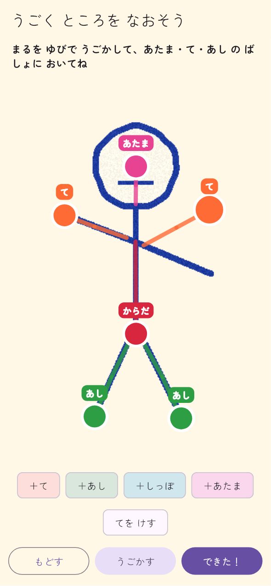

- **読まなくても使える**: ハンドルは色＋アイコン（かお＝あたま、て＝手、あるく人＝あし、足あと＝しっぽ、ハート＝からだ）。ボタンもアイコンが主で、下に短いひらがな（＋て・＋あし・＋しっぽ・けす・もどす・さいしょ・できた！）。説明文は出さない。
- **大きな的**: ハンドル半径 26dp（白いふち込みで直径約 58dp）、当たり判定は半径 44dp（指が少しずれてもつかめる。テストあり）。選ぶとひと回り大きくなり黄色い輪。選んだ手足は付け根（肩・股）の小さなハンドルも出て、付け根も動かせる。肘・膝は自動で真ん中。
- **すぐ分かる結果**: 右上の小窓で、いまの骨で「あるく → パンチ → ぴょん → キック」をずっと再生（指を離すたびに作り直し、Isolate・低品質メッシュ）。
- **こわくない**: もどす（1 ドラッグ＝1 段、40 段）、さいしょ（自動リグに戻す、これも 1 段なので戻せる）。手足の数に上限（手 4・足 6・しっぽ 2、合計 12）。
- **はじめての時**（誕生直後）: 最初の手（か頭）のハンドルに、波紋と指アイコンが左右に揺れる手本アニメ。触ると消える。戻る矢印は出さず「あとで」だけ（押せばキャラのページへ）。
- 誕生直後の流れ: なまえ → 「うごく ところを なおそう」→ キャラのページ（動画の案内も従来どおり）。スキップしたら何も保存しない（次に開いたときも自動リグから）。
- 保護者向けの細かい操作（肘・膝・つの）は v2.0 では出さない（子どもの迷いを減らす）。

## 4. アプリ内お絵かきツール（SPEC §12.2 入力②）

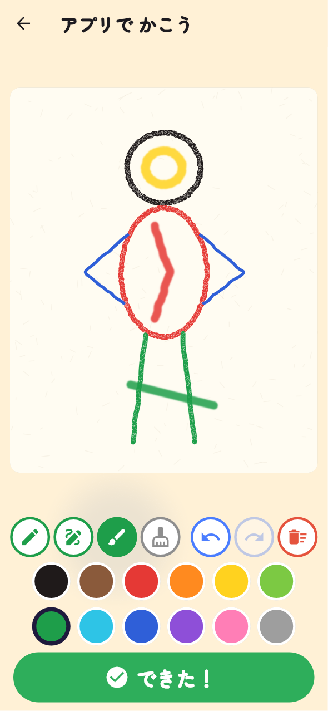

- 筆: **クレヨン**（太さ 16、ろうの粒で紙が少し透ける）、**ペン**（10、くっきり）、**ふで**（26、ふちがやわらかく少し透ける）、**けしごむ**（34、線だけ消す。紙は消えない）。筆圧なし（指でもペンでも同じ線）。色は 12 色（くろ・ちゃいろ・あか・オレンジ・きいろ・きみどり・みどり・みずいろ・あお・むらさき・ピンク・はいいろ）。色を押すとけしごむから自動でクレヨンに戻る。
- もどす / やりなおす。「ぜんぶけす」は確認ダイアログ（大きなゴミ箱アイコン、けす / やめる）。消した後でも「もどす」で戻る。
- キャンバスは 1000×1250 単位（縦長）。点は 1.5 単位以上動いたときだけ記録（指の震え対策と容量）。上限 600 ストローク・4000 点。
- **取り込み不可**: アルバム・貼り付け・テキスト欄なし（テストで確認）。カメラが既定で、「アプリで かく」は 2 番目のボタン（`draw-in-app`）。

### 4.1 出力

- 白い背景で 1024px（高さ）の PNG に描き出し（画面の紙の質感は入れない: 色の解析が子どもの色だけを見るように）→ 同じ解析 → 切り抜き PNG。
- **ストロークリスト**（`StrokeDrawing` JSON ＋ 切り抜きへの写像 `{k, dx, dy}`）を `PendingBirth.strokesJson` で運び、命名時に `PuppetStore.saveStrokesJson`（端末内だけ。サーバーには送らない）。自動リグ・エディタの「さいしょ」が使う。

### 4.2 写真と同じパイプライン、省いたもの

`analyzeCanvasDrawingSync`（`draw_canvas/canvas_analysis.dart`）:

| 段階 | 写真 | アプリの絵 | 理由 |
|---|---|---|---|
| 正規化・画像ハッシュ | ○ | ○ | 同じ（ハッシュ＝能力の seed） |
| 紙の検出・台形補正 | ○ | **省く** | キャンバスが紙そのもの。紙らしさ = 1、検出済み扱い（写真らしさが上がって「しょぼ」にならないように） |
| ホワイトバランス・セグメンテーション・切り抜き | ○ | ○ | 同じ |
| 特徴・のびのび度・子どもの絵らしさ・属性・能力 | ○ | ○ | 同じ（合成の子どもの絵で skill < 60 を確認。クレヨンの粒・指の揺れが残る） |
| 本物チェック（印刷・画面・写真・デジタル, TRUST §3） | ○ | **省く** | アプリの指で描いたことが確実（取り込み手段が無い）。平らなデジタル画素なので、チェックを通すと「デジタル絵」と誤判定される |
| 「もうすこし かいてみよう」 | ○ | ○ | 同じ |
| クラウド判定（許可時） | ○ | ○（**「手描きでない」判定だけ無視**） | 適切さ・skill の推定は使う。origin（AI/印刷）判定はアプリの絵には当てはまらない |

## 5. 2.5D ステージ

| 開始（さきどり中） | 攻撃 | まる vs かくし要素（ゆきやま） | KO | Lv50 でんせつ（よぞら） |
|---|---|---|---|---|
| 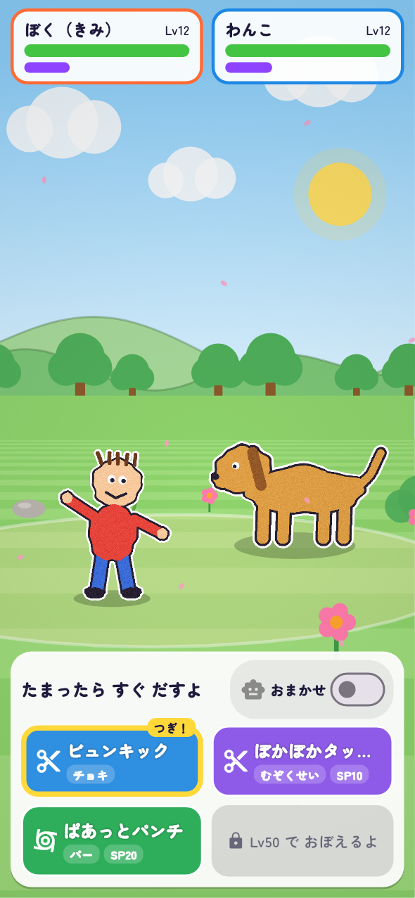 | 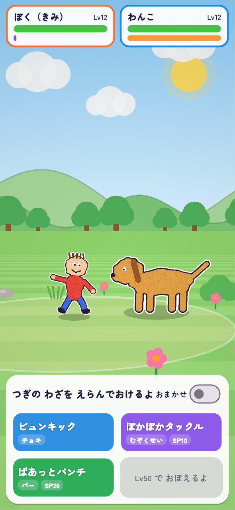 | 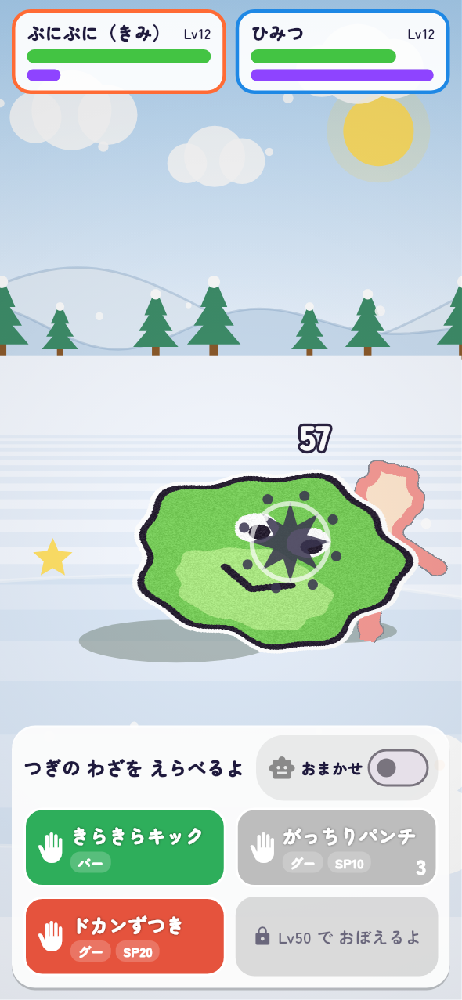 | 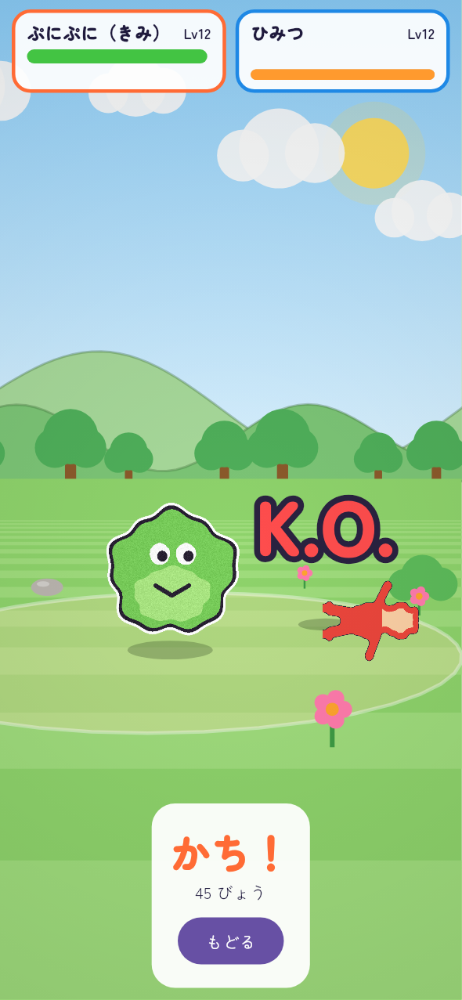 | 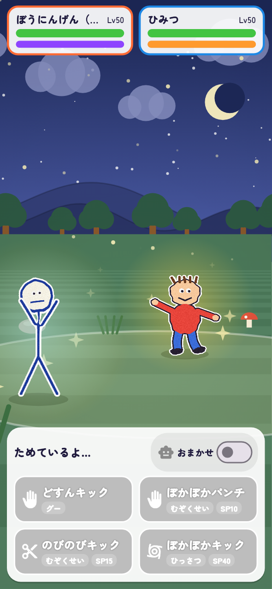 |

| うみ | もり | さばく | おかし | かざん（低品質） |
|---|---|---|---|---|
| 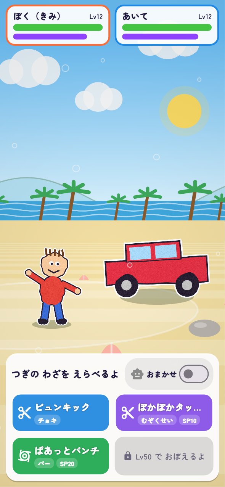 | 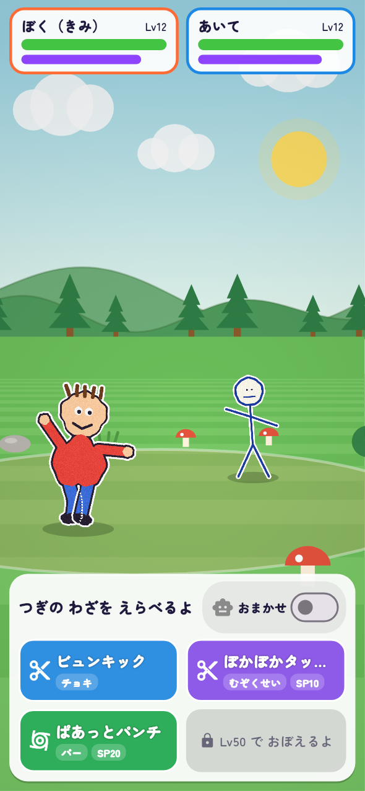 | 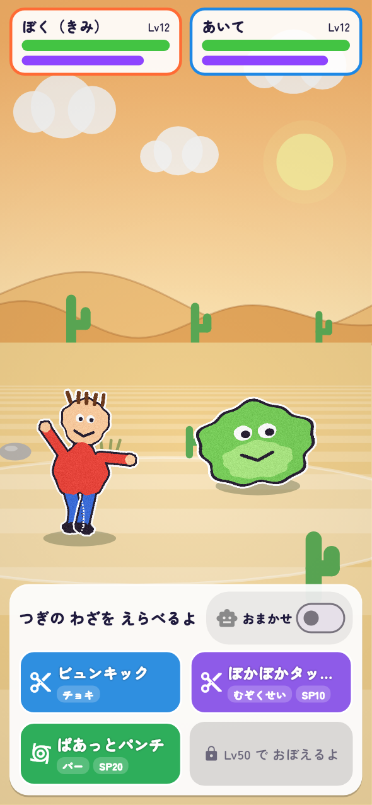 | 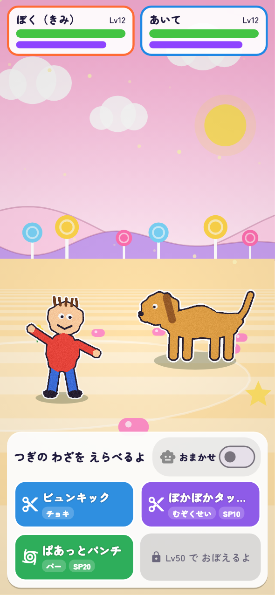 | 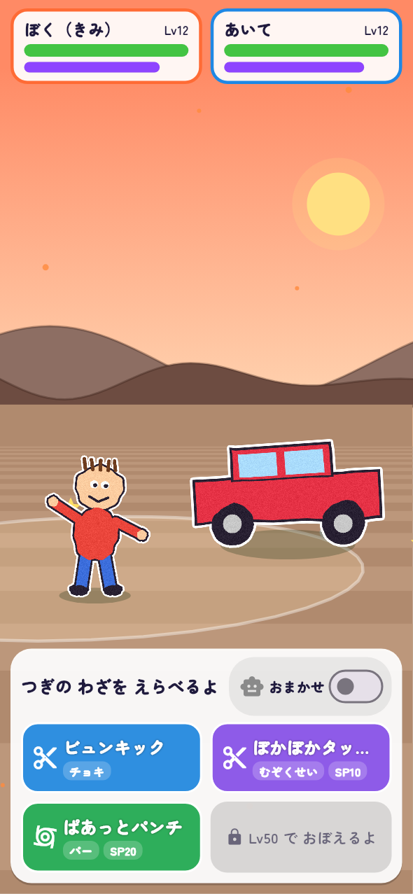 |

- **テーマ**（`StageTheme`）: くさはら・もり・うみ・さばく・ゆきやま・おかしのくに・かざん・よぞら。空の色・遠い/近い丘（うみは海）・木の形（丸・針葉樹・ヤシ・ぺろぺろキャンディ・サボテン）・地面の縞・小物（花・石・草・貝・雪だるま・お菓子・サボテン・きのこ・星）・舞うもの（花びら・雪・泡・星・火の粉）。`forWorld(1..10)` = くさはら, もり, うみ, さばく, ゆきやま, おかし, かざん, よぞら, もり, おかし。
- **背景のキャッシュ**: 空・遠い丘・近い丘・木の列は形がカメラで変わらないので、画面サイズごとに `Picture` に 1 回だけ記録し、パララックス（0.12 / 0.25 / 0.4）で平行移動して描く。地面と小物は本当の透視。
- 演出（スパイクから）: 自動移動（近づく・回る・下がる・待つ）、物理技はダッシュ→クリップ→当たった瞬間に数字・エフェクト・HP、遠距離は撃つ→飛ぶ→当たる、自分への技はハート・星が立ち上る。2 つの行動が重なると 2 つ目はダッシュ省略。カメラは 2 体（倒れた体も）が必ず入るまで引く（テストで 97 % 以上のフレーム）、攻撃側に寄る、当たるとゆれる（会心・ばつぐんで強く。`reducedMotion` でゆれ 0）。
- **VFX**: 15 種（slash, punch, beam, orb, burst, wave, rain, spiral, stars, hearts, bubbles, leaves, sparks, shield, glow）× 11 色（rainbow は粒ごとに虹色）。飛ぶもの・当たるもの・自分にかかるもので形が変わる（雨は落ちる、葉はくるくる、泡はふち、など）。強さ: シンプル 0.5・普通 1・でんせつ 1.4・ひっさつ ×1.25。**描いたわざの絵**（LOOP §3）は `drawnEffects` を渡すと飛んで・はじける。
- 文字: ダメージ（会心はオレンジ大、いまひとつは灰色）、回復（緑 +）、「かいしん！」「ばつぐん！」「いまひとつ…」「はずれ」「ねばねば！」「ビリビリ！」「まもり！」「パワーアップ！」「よわくなった」「K.O.」。
- 状態: キャラの色味（紫・黄）、泡・稲妻、まもりの膜、頭の上に丸いアイコン（しずく・稲妻・盾）。パネルにも同じアイコン（＋つよく/よわく の矢印）。

## 6. データ・他チームへ

- **Engine v3**: Character v2 の `rig` に `CharacterRig.encode()`（≤ 2 KB）を入れ、`registerCharacter` で送る。サーバー側の検証は `CharacterRig.validate()` と同じ規則（版・大きさ・座標の範囲・12 本・attach）で、不正なら空にして自動リグ。`drawingSource`（camera / canvas）は `PendingBirth.strokesJson != null` で分かる。かくし要素のフラグは `PuppetLook.of` にだけ渡す。ステージには `StageFeed` を実装したアダプタを 1 つ。
- **統合**: 命名後の遷移は `Routes.characterJoints(id, first: true)` に変更済み。キャラ詳細に「うごく ところを なおす」（`detail-joints`）を追加済み。`main.dart` で `FilePuppetStore`。おわかれ・全削除で `PuppetStore` も消す（`CharactersController`）。
- **Trust**: アプリの絵は本物チェックを通さない（§4.2）。取り込み手段が無いことはウィジェットテストで固定。
- **Loop**: 描いたパーツは `characterPuppetSpec` が合成画像＋パーツごとの骨にする（帽子・つの → 頭に付く、もちもの → いちばん近い手、はね → はばたく、しっぽ → 腰から振る、かざり → 体）。骨が 12 本を超えるときは自動で見つけた短い「つの」から外す。
- データセット（Amateur Drawings）はコミットしていない。

## 7. 性能とメモリ

`test/features/puppet/perf_test.dart`（デスクトップ x86 JIT、393×851、1,200 フレーム平均。2 体＝人と犬、くさはら）:

PERF_TABLE

- 低価格端末（Cortex-A53 級、AOT、JIT の 5〜8 倍遅いと仮定）でも UI スレッド 2〜5 ms。キャラの作成は Isolate で 1 回（`PuppetBuilder` が画像＋リグ＋見た目＋品質でキャッシュ）。
- **自動品質切り替え**（`AdaptiveQuality`）: 実フレーム（build＋raster）が 20 ms を超える割合が 25 % 以上の窓（約 1.5 秒）が 2 回続いたら低ティアへ。戻さない（ちらつき防止）。低ティア: メッシュ 40 セル、小物半分、雲・ビネットなし、粒 40 %。`onQualityChanged` で次のバトルの初期値を覚えておける。
- **メモリ**: 1 体のテクスチャ（最大 約 524² RGBA ≒ 1.1 MB）＋メッシュと重み（60〜150 KB）。2 体で CPU 側 約 1.5 MB（テストで 4 MB 未満を確認）、ビルドキャッシュは 8 MB 上限（LRU、テストあり）。GPU テクスチャはスプライトと同じ寿命。
- **描画テスト**: `flutter test` のソフトウェア Skia で `drawVertices`＋`ImageShader` を通して PNG を書く（ゴールデン比較はしない）。`PUPPET_WRITE_DOCS=1 flutter test test/features/puppet test/features/battle_stage test/features/draw_canvas` で `docs/v2_25d/` を更新。

## 8. 未決定・確認したいこと

1. 実機: Impeller の `drawVertices`＋`ImageShader`（Android 10+ / iOS）、GLES2 の古い端末の raster 時間（V2_25D_TECH §8.4 のチェックリスト）。
2. 4〜8 歳の子がエディタの丸をつかめるか・何をする画面か分かるか（プレイテスト）。分からない子が多ければ、誕生直後は「うごきを みる」→ 変なときだけ「なおす」に変える。
3. お絵かきツールの絵の「子どもの絵らしさ」が紙の絵と同じ分布になるか（合成では skill < 60）。実データで偏るなら解析側の係数を Vision チームと調整。
4. 写真の「体にくっついた腕」は線が薄い・塗りだけの絵でまだ取れない。次の一手は色の境界（服と肌）での分割（1 週程度）。
5. ストロークの所有（腕だけ）でまれに出る、手と腰の境目の細かい欠け。気になる場合はストロークごとに別メッシュ（工数 0.5 週）。
