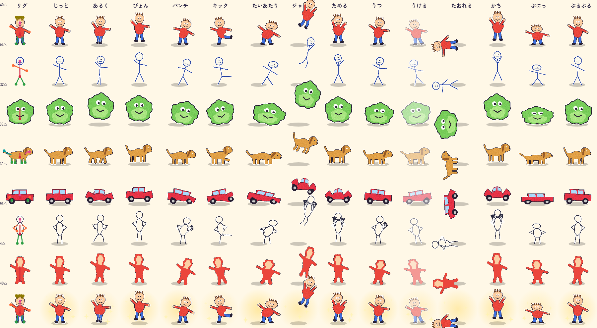

# v2.0 2.5D 技術スパイク（2.5D Spike チーム）

> **製品化済み（Puppet チーム）**: スパイクのコード（`features/spike25d/`）は `features/puppet/`・`features/battle_stage/`・`features/draw_canvas/` に移して削除した。現在の仕様・精度・性能は `docs/PUPPET.md`。以下はスパイク時点の記録。

オーナーの質問「**3D の代わりに、絵のパーツを 2D で動かす（2.5D）方式にすれば、費用を抑えられるか？**」に、動くプロトタイプで答えたもの。
コードは `spike/25d` ブランチの `app/lib/features/spike25d/`（テストは `app/test/features/spike25d/`）。消すときはこの 2 つのフォルダ、`docs/v2_25d/`、ルーターの数行（§9）を戻すだけ。

> **結論: できる。おすすめは「2.5D 梅」を v2.0 にすること。**
> - 子どもの絵を**端末の中だけで**自動リグ（骨入れ）し、腕・脚・頭・しっぽを曲げて動かせた。描画は Flutter の普通の `Canvas.drawVertices` なので **Android 7〜9 でも iPhone でも同じコードで動く**（3D 梅は Android 9 以下で使えず、2D の代わりの画面が必要だった）。
> - 運用費は 3D 梅より下がる（クラウド 3D・GLB の配信が無い）。サーバーは Claude の審査と対戦サーバーだけ。**1k DAU で月 約 $30〜40（¥4,500〜6,000）**。¥5,000 に収めるには対戦サーバーの上限設定が要る（§8.2）。
> - 開発の工数は 3D 梅とほぼ同じ（**約 12 週 vs 13 週**）だが、**リスクが小さい**（`flutter_scene` 1.0 前・Impeller 必須・背中の見た目・APK +3 MB・GPU 描画テストが全部不要）。
> - 弱点: 自動リグの正解率は子どもの絵の実データで**「頭・両手・両足が全部だいたい正しい」が 4 割**。残りは **ジョイントエディタ（子ども・保護者が丸を動かす）**で直す前提。間違っていても「出っ張りが揺れる・曲がる」ので壊れた見た目にはならない。カメラが回り込めない（キャラは平らな切り絵）ので、SPEC §12.4 の「奥行きのある 3D バトル」は**「奥行きのある 2.5D」に読み替える必要がある**（オーナー判断）。

---

## 0. 比較表（PM 向け）

工数はクライアント側、AI エージェント併用のエンジニア週（3D スパイクと同じ単位）。運用費は infra の試算（`docs/V2_INFRA.md` §4）からクラウド 3D と GLB 配信を除いたもの。

| | **2.5D 梅（このスパイク）★推奨** | 3D 梅（`V2_3D_TECH.md`） | 3D 竹 |
|---|---|---|---|
| 子どもに見えるもの | 自分の絵が**そのまま切り絵として**立ち、**腕を振る・脚で歩く・頭をかしげる・しっぽを振る**。手足の無い絵（まる・車）は全体がぷにぷに伸び縮みしてはねる。奥行きのある草原（遠いほど小さく上に）、影、パララックスの背景、攻撃のたびにカメラが寄ってゆれる、技ごとのエフェクト（15 種 × 11 色）、ダメージ数字 | 絵がぬいぐるみのように膨らんだ立体。骨は 3 本（足元・胴・頭）で、腕や脚は曲がらない。カメラが回り込む。背中は鏡像 | 梅 ＋ クラウド生成の本格 3D フィギュア |
| 描画 | Flutter の `Canvas`（Skia / Impeller どちらでも）。新しいパッケージなし | `flutter_scene`（Flutter GPU / Impeller 必須、1.0 前） | 同左 |
| Android 7〜9（minSdk 24） | **◎ 同じ画面**（GLES 2 の Skia でも `drawVertices` は使える） | ✕ 2D の代わりの画面を別に作る（+1.5 週）か minSdk 29 | ✕ 同左 |
| iOS | ◎ 同じコード | ◎ | ◎ |
| 端末での処理 | 骨入れ＋メッシュ＋重み: 1 体 **約 30〜300 ms**（デスクトップ JIT、§6）。1 フレームの CPU **約 0.5 ms**（2 体＋ステージの記録） | inflate 0.17〜0.22 秒。フレーム 0.3 ms ＋ GPU | 同左＋クラウドモデル |
| メモリ | キャラ 2 体で **約 1.5 MB**（CPU）＋ テクスチャ 2 枚 | 150 MB 以内を目標（影マップなど） | もっと大きい |
| APK | **ほぼ +0**（Dart コードだけ） | +3.0 MB | +3.0 MB |
| 工数 | **約 12 週**（§7） | 約 13 週 | 約 23 週 |
| 月の運用費（1k / 10k DAU） | **約 $30〜40 / $80〜225**（Claude、対戦サーバー、Firebase のみ） | 約 $40〜85 / $175〜225 | 約 $140〜170 / $550〜600 |
| SPEC §12 | 12.2 端末で作る ◎（2D の動きで代用）／クラウド 3D ✕（使わない）／しょぼキャラ ◎／Lv50 の作り直し ◎（本格リグに変わる）。12.3 ◎。12.4 奥行き △〜○（2.5D）・自動移動 ◎・カメラ ○（パン・ズーム・ゆれ、回り込みなし）・ATB ◎。12.5 ◎ | 12.2 クラウド 3D ✕〜△ 以外は ◎、12.4 ◎ | すべて ◎ |
| 主なリスク | 自動リグの精度（エディタで補う）、カメラが回り込めない、技の演出がテンプレート頼み | `flutter_scene` 1.0 前、Impeller の GLES 端末、背中の見た目、低価格端末の発熱 | 梅＋クラウド 3D の品質・費用 |

**推奨**: v2.0 は **2.5D 梅**で出す。SPEC §12.2 の「3D 化」と §12.4 の「3D バトル」は「2.5D（切り絵が関節で動く・奥行きのあるステージ）」に変更する（オーナーの決定事項として SPEC を改訂）。クラウドの画像→3D は v2.0 では使わない（§8.3 に、あとで足す場合の形を書いた）。

---

## 1. 作ったもの（全体）

```
切り抜き PNG ──(Isolate, 純 Dart)──▶ 自動リグ ─▶ メッシュ＋スキン重み ─▶ RiggedCharacter
   └ 保存したリグ（エディタで直したもの）があれば、それを使う             │
                                                                         ▼
v3 ATB エンジン（10 Hz, 整数）──イベント──▶ Director25（純 Dart, 決定的）──▶ StagePainter（Canvas）
   ▲ 技ボタン・さきどり・おまかせ（Flutter の Widget）                       └ CharacterSprite.drawVertices
```

| ファイル | 内容 |
|---|---|
| `rig/bin_mask.dart`, `rig/skeleton.dart` | 2 値マスク、距離変換、Zhang–Suen 細線化 → 骨格グラフ → 枝刈り |
| `rig/auto_rig.dart` | 頭・腕・脚・しっぽ・その他（角・髪・耳）を決める |
| `rig/rig.dart` | リグのデータ（JSON 0.5〜1 KB）と、骨（pelvis / body / 手足 2 本ずつ）への展開 |
| `rig/rigged_character.dart` | ステッカー風の白いふち、グリッドメッシュ、測地距離のスキン重み、しょぼキャラの見た目 |
| `anim/skinner.dart`, `anim/clips.dart` | 線形ブレンドスキニング（CPU）、手続き型クリップ 11 種 |
| `render/character_sprite.dart` | `Vertices.raw` ＋ `ImageShader` で描く、ヒットの白フラッシュ、状態異常の色 |
| `battle/director25d.dart` | 2.5D カメラ（地面への透視投影）、自動移動、技ごとの動き、エフェクトの指示 |
| `battle/stage_painter.dart` | 空・山・木（パララックス）、遠近の地面、小物、影、エフェクト、数字 |
| `battle/battle_session25.dart`, `battle/battle_25d_screen.dart` | **本物の v3 ATB エンジン**（`domain/battle_v2`）との接続、画面と UI |
| `editor/joint_editor_screen.dart`, `editor/rig_edit.dart` | ジョイントエディタ、リグの保存（`RigStore`） |
| `spike25d_debug_page.dart` | デバッグ入口 `/debug/25d`（debug ビルドだけ） |

---

## 2. 端末内の自動リグ（質問 1）

### 2.1 手順（純 Dart、決定的、乱数なし）

1. 切り抜きのアルファ（≥128）を、**キャラの外接矩形に切り詰めてから**長辺 160 px に縮める（被覆 30 % 以上を前景にするので、1〜2 px の棒人間の線も切れない）。closing 1 px → 穴埋め → 最大の連結成分。
2. 正確なユークリッド距離変換（AR チームの `squaredDistanceTransform` を再利用）。
3. **Zhang–Suen 細線化** → 冗長な画素（階段の角）を除く → 端点と分岐点をノードにしたグラフ。穴を埋めているので必ず木になる。
4. **枝刈り**: 葉の枝が分岐点の内接円からどれだけ「はみ出すか」 `|先端−分岐| + r(先端) − r(分岐)` が `max(サイズの 3 %, 0.25·r(分岐))` 未満なら輪郭のギザギザとみなして消す（小さい順に繰り返す）。指（同じ分岐から短い葉が 2 本以上）は手首にまとめる。
5. **役割を決める**:
   - **頭**（縦長の絵）: 上 60 % の中で**一番大きい内接円**（高さと中心線に近いほど加点）。子どもは頭を大きく丸く描くので、「一番上の葉」（髪・帽子・耳に引っぱられる）より大幅に当たる（頭の PCK@10 %: 26 % → 62 %）。頭の円から上に出る葉は「つの」（髪・耳・帽子＝ゆらゆら揺れる）、頭の中で終わる葉（首）は捨てる。1 つの丸い塊（頭＝体）は頭にしない。
   - **脚**: 下 40 % にあって下を向く葉。下にあるものから 2 本（横長の絵は 4 本＝動物）。
   - **腕**: 左右それぞれで一番外に伸びる葉（下に垂れた腕も可。足元の葉と、中心線を真上に伸びるアンテナは除外）。4 本脚の動物には腕を付けない。
   - **しっぽ**: 横長の絵で、頭と反対側の葉。
   - 残りは「つの（extra）」: 揺れるだけ。
   - **体**: 脚の付け根の平均を `root`（骨盤）、腕の付け根を `chest`。脚が無ければ体の下の方。
6. 関節: 付け根＝枝が分岐の内接円を出るところ、肘・膝＝付け根から先端までの道のりの半分、先端＝端点。

**手足の無い絵（まる・車・ぐるぐる）**: 葉が無ければ体だけのリグになり、クリップは全体の伸び縮み・ジャンプ・傾き・**ぷにぷに揺れ**（高さに応じた横ゆれ）で動く（§4）。

### 2.2 メッシュとスキン重み

- **グリッドメッシュ**: 白いふちを付けたテクスチャの不透明部分にかかるセル（長辺 64 セル）を 2 三角形ずつ。輪郭の正確さはテクスチャのアルファが出すので、三角形分割は単純でよい。サンプルで **1,200〜4,000 三角形**（低ティアは 40 セルで約 1,000）。
- **離れた部品をつながない**: 各格子点の周り 2×2 セルの中で画素の連結成分を数え、つながっていない部分には**別の頂点**を作る（腕が脚の近くを通っても、動かしたときに一緒に引っぱられない）。
- **重み**: マスクの**中を通る測地距離**（8 近傍のダイクストラ、長辺 128 の格子）で各骨からの距離 d を出し、`w ∝ 1/(1+d)^4` の上位 4 本を正規化。ユークリッド距離と違い、腕の重みが隣の脚や胴に漏れない。
- スキニング: 骨ごとの 2D アフィン行列（配置・反転を含む）で `Σ wᵢ·Mᵢ·v`。

### 2.3 実際の子どもの絵での精度（Meta Amateur Drawings, MIT）

手元のサンプル 300 枚（150 枚は調整用、150 枚は**調整に使っていない hold-out**）のうち、アノテーションが取れた 293 枚。アノテーション（関節 17 点・マスク）は公開 JSON（288 MB）から **HTTP Range で必要な分だけ（計 約 43 MB）**取り出した（`/home/user/datasets/ad_meta_ann/`、リポジトリには入れていない）。
誤差は「キャラの外接矩形の長辺」で割った値。左右は入れ替えて近い方で採点（子どもの正面の絵は左右があいまい）。頭の正解は鼻と両目の平均。

再現: `AD_DIR=/home/user/datasets/ad_meta AD_ANN=/home/user/datasets/ad_meta_ann/sample_annotations.json AD_OUT=/tmp/rig_eval flutter test test/features/spike25d/rig_eval_test.dart`（`AD_DIR` が無ければ skip）。

| | GT マスク（リグだけの性能）n=293 | 調整用 / hold-out | アプリの切り抜き（Vision）n=262 |
|---|---|---|---|
| **成功**（頭・両手・両足が見つかり、全部 10 % 以内） | **27.6 %** | 24.7 / 30.6 % | 16.4 % |
| **だいたい合う**（5 点とも 20 % 以内） | **43.0 %** | 42.5 / 43.5 % | 25.2 % |
| 形がそろう（頭＋腕 2＋脚 2 を見つけた） | 68.6 % | 71.9 / 65.3 % | 62.2 % |
| 何かしら動く部分がある | 99.7 % | | 95.4 % |
| 頭 PCK@10 % / 見つかった率 | 62.1 % / 99 % | 61.6 / 62.6 % | 53.8 % |
| 手 PCK@10 % / 見つかった率 | 43.3 % / 73 % | 44.5 / 42.2 % | 26.0 % |
| 足 PCK@10 % / 見つかった率 | 65.5 % / 92 % | 66.4 / 64.6 % | 46.6 % |
| 肩 / 肘 / 腰 / 膝 PCK@10 % | 37.9 / 37.9 / 54.9 / 59.4 % | | 23.3 / 24.0 / 41.2 / 40.8 % |
| 見つかったときの誤差の中央値（頭 / 手 / 足） | 0.058 / 0.074 / 0.051 | | 0.070 / 0.157 / 0.086 |
| 時間（リグ）中央値 / p90 | **8 ms / 13 ms** | | 8 / 13 ms |
| 時間（メッシュ＋重み）中央値 / p90 | **25 ms / 41 ms** | | 27 / 50 ms |

（時間はデスクトップ x86 の JIT、PNG のデコードは含まない。「アプリの切り抜き」は紙の台形補正が起きなかった絵だけ（座標が GT と同じ）で、注釈されたキャラの枠＋10 % に絞った。子どもが 1 体だけ切り抜く想定。）

**調整用と hold-out がほぼ同じ**なので、パラメータ（4 つだけ）への過学習は無い。

失敗の主な理由（オーバーレイ画像を目で確認）:
1. **腕が胴にくっついて描かれている**（手を腰に・ドレスの横に垂らす）→ 穴埋めで腕が胴に吸収される（手が見つからない 27 % の大半）。
2. 長い髪・リボン・持ち物（剣・風船）を腕と取り違える。
3. データセットのマスク自体がノートの罫線や地面の線を含んでいる（GT が汚い）。
4. アプリの切り抜きは、薄い線の途切れ・影・周りの落書きで形が崩れる → 精度が下がる（16 % / 25 %）。

**製品での見込み**: **アプリ内のお絵かきツール**で描いた絵は、筆の軌跡（ストローク）が分かるので、1 と 4 がほぼ無くなる（ストロークごとに「腕の線」「胴の輪郭」を分けられる）。紙の絵は「だいたい合う」4 割＋エディタ、ツールの絵は 6〜7 割を目標にできる（要検証、§7 の 2 週に含めた）。Meta の Animated Drawings は人型専用の学習済みモデル（Mask R-CNN＋姿勢推定、サーバー）でこれより高精度だが、**人型しか扱えず、サーバー GPU が要る**ので、このアプリの条件（端末内・¥5,000/月・動物や車も来る）には合わない。

**間違ったリグでも壊れない**: 腕を脚と取り違えても「出っ張りが振れる」だけで、絵が裂けたり飛んだりはしない（測地距離の重み＋部品を分けたメッシュ）。だから「自動で 6〜7 割は気にならない、気になったら直す」という使い方ができる。



*左端が自動リグ（赤＝体、桃＝頭、橙＝腕、緑＝脚、青緑＝しっぽ、黄土＝つの）、右へ じっと／あるく／こうげき（腕振り）／ジャンプ／ためる／うける（白フラッシュ）／たおれる。上から 人・棒人間・まる（手足なし）・犬（横向き、4 本脚＋しっぽ）・車・しょぼキャラ。*

---

## 3. ジョイントエディタ（質問 2）


- 大きな丸（指で触れる 36 px の当たり判定）を**ドラッグするだけ**。色とひらがな（あたま・て・あし・しっぽ・からだ）で区別。肘・膝は自動で中間に置き直す。
- 「＋て／＋あし／＋しっぽ／＋あたま」で追加、選んだものを「〜を けす」、「もどす」で自動リグに戻す、「うごかす」でその場で動きを確認、「できた！」で保存。
- 保存: `CharacterRig.toJson()`（0.5〜1 KB、座標は切り抜き PNG のピクセル、`v: 1`、`source: auto|edited`）。スパイクでは `rigs/<imageHash>.json`（`FileRigStore`）。**製品では `Character` に `rig` フィールドを足し、`registerCharacter` で一緒に送る**（オンラインの相手の端末も、直したとおりに動かす必要があるため）。サーバーでは大きさ・座標の範囲・手足の数（≤ 12）だけ検証する。知らない版の JSON は捨てて自動リグに戻す。
- 子ども向けの工夫（製品化で実施）: 最初の 1 回だけ「まるを うごかしてみよう」の手本アニメ、保護者モードでは肘・膝も見せる。キャラ作成の最後に「うごきを みる」→ 変なら「なおす」の流れにする（全員に見せない）。

---

## 4. アニメーション（質問 3）

すべて**手続き型**（キーフレームのデータなし）。`evaluateAnim(clip, t, ctx, fwd, pose)` が骨の回転・体の伸縮・ずれを出し、どんな形のリグにも使える。

| クリップ | 手足のある絵 | 手足の無い絵（まる・車）・しょぼキャラ |
|---|---|---|
| じっと（idle） | 呼吸（体積を保つ伸縮）、腕と頭が小さく揺れる | 伸縮＋ぷにぷに |
| あるく（walk） | 脚を交互に振る・膝を曲げる、腕を逆に振る、上下動、前傾。4 本脚は対角 | ぴょんぴょん（着地でつぶれ、空中で伸びる） |
| こうげき | **腕振り**（振りかぶり→前下へ）、腕が無ければ**けり**、無ければ**体当たり**。3 回に 1 回は**ジャンプ攻撃** | 体当たり・ジャンプ |
| ためる（cast） | 両腕を上げて光る（回復・強化・まもり・溜め技） | ふくらむ＋光る |
| うつ（shoot） | 腕を相手に向ける（ビーム・弾・状態異常） | 縮んで発射 |
| うける（hit） | のけぞり（減衰振動）、白フラッシュ、手足がばたつく | ぷるぷる |
| たおれる / かち | 後ろに倒れる / 両手を上げてはねる | 同じ |

- **向き**: 横向きの絵（頭やしっぽが中心からずれている）は、頭が相手を向くよう左右反転。**正面の絵は反転しない**（字や顔が鏡文字にならない）。
- **技ごとの演出**: 技の `vfx`（15 種: slash, punch, beam, orb, burst, wave, rain, spiral, stars, hearts, bubbles, leaves, sparks, shield, glow）と `colour`（11 色）をそのまま使う（AI が名前と演出を決め、数値はゲームが決める §12.3 と同じ形）。打撃は星のはじけ・斬撃の弧・うず、遠距離はビーム・稲妻・粒の群れ・光の玉、自分への技はハート・星が立ち上る。状態異常はキャラの色味（紫・黄）と泡・稲妻、まもりは泡の膜。
- 描画: `Vertices.raw(triangles, positions, textureCoordinates, indices)` ＋ `ImageShader`。白フラッシュと状態の色は同じ頂点を `ColorFilter(srcATop)` でもう 1 回描くだけ。

---

## 5. 2.5D バトルのステージ（質問 4）

- **地面への透視投影**: カメラは地面から 1.7 m の高さ。キャラの足元の点だけを投影し、絵はその点に立つ切り絵として**奥ほど小さく・上に**描く。影は足元の楕円で、ジャンプすると小さく薄くなる。小物（花・石・草むら）とキャラを奥から順に描くので、前後の重なりが正しい。
- **パララックス**: 雲 0.05、遠い山 0.12、近い山 0.25、木の列 0.4、地面の縞と小物は本当の透視。
- **カメラ**: 2 体の中間にパン、間隔に合わせてズーム、**2 体（倒れた体も）が必ず画面に入るまでズームアウト**（テストで 97 % 以上のフレーム）、足元が画面の 64 % の高さに来るよう上下を合わせる（HP 表示と技ボタンにかぶらない）。攻撃中は攻撃側に寄って 1.2 倍、当たるとゆれる（会心で強く）、KO は勝者寄りで 2 体を映す。
- **自動移動**: 「近づく・横に回る（奥行き方向）・下がる・待つ」を 1〜2.5 秒ごとに選ぶ。プレイヤーは手前、相手は奥の帯を動く（縦画面で見やすい配置。3D スパイクと同じ考え方）。物理技は相手の前までダッシュ → 攻撃クリップ → 当たった瞬間に数字・エフェクト・HP 減少 → 戻る。特殊技は撃つ→飛ぶ→当たる。
- **本物のエンジン**: ゲーム設計チームの v3 ATB エンジン（10 Hz・整数・`newBattle` / `aiController`）をそのまま回し、イベント（`choose / move / damage / miss / crit / heal / status / stage / shield / end`）から演出を作る。**画面の HP は当たった瞬間に減らす**。行動が重なったら 2 つ目以降はダッシュを省いた短い版（GAME_DESIGN_V2 Q6 の「時間を止めない」案）。オンラインはサーバーのイベント列を 150〜250 ms 遅らせて同じ `Director25` に流すだけ。
- **UI**: 上に HP（緑→黄→赤）と ATB ゲージ（満タンでオレンジに光る）、状態のバッジ。下に技ボタン 2×2（属性の色、グー／チョキ／パー／むぞくせい／ひっさつのタグ、SP、クールダウンの秒数、Lv で解放される枠）、満タンのときは 5 秒のカウントダウンの輪、**さきどり**（ゲージがたまる前に押すと黄色い枠と「つぎ！」、満タンの tick に出る。テスト済み）、おまかせスイッチ。
- テスト: `battle_session_test.dart`（KO まで進む・画面内に入る・さきどり・5 秒でおまかせ・決定的・しょぼキャラの判定・投影）、`battle_render_test.dart`（下の画像を描く。`SPIKE25D_WRITE_DOCS=1` で `docs/v2_25d/` に保存）。

| 開始（さきどり中） | 犬（横向き・反転）に攻撃 | まる vs しょぼキャラ（体当たり） | KO | Lv50「でんせつ」（ひっさつ 4 つ目） |
|---|---|---|---|---|
|  |  |  |  |  |

ほかのフレーム: `battle_choose.png`, `battle_6s.png`, `battle_9s.png`。デバッグ入口: `/debug/25d`（`flutter run --dart-define=INITIAL_ROUTE=/debug/25d`）。サンプル 5 種・ずかんのキャラ・相手の種類・隠し要素・Lv50・低画質を選べ、エディタも開ける。

---

## 6. 性能とメモリ（質問 6）

`perf_test.dart`（デスクトップ x86、JIT、393×851 の縦画面、1,200 フレームの平均）:

| | 2 体の三角形 | 1 体の作成（デコード〜重み） | エンジン＋演出 | スキニング 2 体 | ステージ全体の記録（スキニング・Vertices を含む） | CPU メモリ（2 体） |
|---|---|---|---|---|---|---|
| グリッド 64（標準） | 4,736 | 約 100〜300 ms（初回は JIT の分遅い） | **約 25 µs** | **約 85 µs** | **約 0.5 ms** | 約 1.5 MB |
| グリッド 96（細かい） | 11,012 | 約 100〜190 ms | 約 17 µs | 約 150 µs | 約 0.5 ms | 約 1.6 MB |
| グリッド 40（低ティア） | 2,168 | 約 70〜80 ms | 約 10 µs | 約 50 µs | 約 0.3 ms | 約 1.4 MB |

- **低価格端末の見込み**（Cortex-A53 1.4 GHz 級、AOT。デスクトップ JIT の 5〜8 倍遅いと仮定）: UI スレッド **約 3〜4 ms/フレーム**、キャラ作成は Isolate で **0.5〜1.5 秒**（作成時に 1 回だけ。`imageHash` でキャッシュ）。
- **GPU（ラスタ）**: 三角形 5 千個のテクスチャ描画、グラデーション数枚、パス数百本。Android 7〜9 の GLES 2（Mali-T720 / Adreno 306 級）で **6〜12 ms と見込む**（実機で要確認）。低ティアは雲・ビネット・小物の半分・粒子を減らし、グリッド 40、30 fps 上限にする（`lowQuality`）。重くなる原因はキャラより背景の毎フレーム描画なので、製品では**背景をカメラが止まっている間 `Picture` / 画像にキャッシュ**する（工数に含めた）。
- **メモリ**: テクスチャ（最大 524×524 の RGBA、約 1 MB）×2 を GPU に 1 回アップロード、頂点は毎フレーム作り直す（数十 KB）。3D の目標 150 MB に比べて桁違いに小さい。
- **ヘッドレス描画**: 普通の `flutter test`（ソフトウェア Skia）でそのまま描ける。GPU のエミュレーション（SwiftShader）もシェーダのビルドも要らないので、CI で毎回スクリーンショットを比べられる。

---

## 7. 製品化の工数（2.5D 梅、エンジニア週、AI エージェント併用）

| 項目 | 週 |
|---|---|
| 自動リグの品質: お絵かきツールのストロークを使う、紙の絵の穴・細い線・付属物、Isolate 化、`imageHash` キャッシュ、実データで再評価 | 2 |
| ジョイントエディタの製品化（はじめての手本、保護者モード、`Character.rig` とサーバー検証、オンラインの相手に配る） | 1.5 |
| クリップと演出の作り込み（10 テンプレート × 15 vfx、4 本脚の歩き、ガード・よろこぶ、進化 Lv10/25/50/75/100 の見た目） | 3 |
| ステージ（3 種類のテーマ、背景のキャッシュ、カメラ演出、結果画面） | 2 |
| v3 エンジン（済）とオンライン（イベント再生・遅延・追いつき） | 1.5 |
| 性能ティアの自動選択、実機 QA（Android 7〜9 を含む 6 機種、iOS 2 機種） | 1.5 |
| しょぼキャラ → Lv50 の作り直しの演出、ずかん・カード・動画書き出しで同じ動きを使う | 0.5 |
| **合計** | **約 12 週** |

3D 梅（13 週）には 2D の代わりの画面（1.5 週）と背中のテクスチャ（1 週）が含まれ、腕・脚を曲げる機能は無い。2.5D 梅は同じくらいの工数で、全端末が同じ画面になり、手足が動く。2.5D に「竹」に当たる追加（クラウド 3D）は無い。v2.1 以降の伸びしろは §8.3。

---

## 8. 費用・SPEC §12・リスク

### 8.1 SPEC §12 の達成度

| 項目 | 2.5D 梅 |
|---|---|
| 12.1 課金なし・リワード広告 | 影響なし（◎） |
| 12.2 入力 2 通り | ◎（お絵かきツールの絵はリグがむしろ楽） |
| 12.2 端末内で立体にして動かす | **△→変更**: 立体にはしない。代わりに「絵が関節で動く」。子どもの絵の味はそのまま（絵を変形しない分、3D より忠実） |
| 12.2 保護者の許可でクラウド 3D | **✕（使わない）**。¥5,000/月の条件と合わない（infra §4.3）。§8.3 |
| 12.2 しょぼキャラ → Lv50 で作り直し・大器晩成（隠し） | ◎ Lv49 までは 3 色・角を丸めた形・骨なし（はねる・ぷるぷるだけ）・エフェクト半分。Lv50 で**本格リグと派手な演出**に変わる。Lv50 は全員「でんせつ」（金色のオーラ・エフェクト 1.4 倍）になるので、隠し要素だけが変わったことは見えない。`bloomer` フラグは UI に渡さない（`Side25` → 見た目だけ） |
| 12.2 見た目に合った能力 | ◎（ゲーム設計の v3 のまま。リグから「腕の数・脚の数」を特徴量に足すこともできる） |
| 12.3 能力・技 | ◎（v3 エンジンで動作確認） |
| 12.4 奥行きのある 3D バトル | **△〜○**: 奥行き（遠近・影・重なり・パララックス・手前と奥の移動）はあるが、カメラが回り込めない。オーナーの決定で「2.5D」に読み替えが必要 |
| 12.4 自動で動く・カメラの動き | ◎ / ○（パン・ズーム・ゆれ） |
| 12.4 ATB・5 秒・おまかせ・さきどり | ◎（本物の v3 エンジン、テスト済み） |
| 12.4 オンラインはサーバーが正 | ◎（演出はイベントを受けるだけ） |
| 12.5 | ◎ |

### 8.2 運用費（月）

クラウド 3D・GLB の保存と配信が無くなるので、残るのは infra 試算（§4.2）の次だけ:

| | 1k DAU | 10k DAU |
|---|---|---|
| Claude（審査＋技の名前・演出、Haiku 級） | 約 $1〜10 | 約 $10〜105 |
| 対戦サーバー（Cloud Run、0 台まで縮む） | 約 $25 | 約 $45〜95 |
| Firebase | 約 $5 | 約 $25 |
| **合計** | **約 $30〜40（¥4,500〜6,000）** | **約 $80〜225** |

¥5,000（約 $33）に収めるには: ①Claude はキャッシュ・Batch API と 1 日の上限（infra §4.4）②対戦サーバーは `max-instances=1`・同時対戦数の上限・混んでいるときはゴースト戦（端末でエンジンを回し、結果はサーバーでリプレイ検証）に切り替える ③Cloud Billing の予算アラートと停止スイッチ。1k DAU を大きく超えたら広告収入（infra の中央値 10k DAU で $315）でまかなう前提。

### 8.3 あとから足せるもの（v2.1 以降）

- **お絵かきツールのストローク**で、パーツを正確に分ける（腕の線は腕）。
- 「**ぶ厚い切り絵**」: 同じメッシュを少しずらして暗い色で重ね描きし、厚紙っぽく見せる（3D 無しで立体感、工数 0.5 週）。
- どうしても 3D が欲しくなったら、3D スパイクの inflate を「ずかんのビューア」だけに使う（バトルは 2.5D のまま）。

### 8.4 リスク

1. **自動リグの精度**（紙の絵で 4 割が「だいたい合う」）→ エディタ、ツールのストローク、間違っても壊れない作り。子どもの実テストで「直したくなる割合」を測る。
2. **「3D じゃない」と感じられる** → 奥行き・影・カメラ・エフェクトで補う。オーナーの判断が必要（SPEC §12.2/§12.4 の改訂）。
3. **古い GPU のラスタ時間**（実機未確認）→ 低ティア、背景のキャッシュ、30 fps 上限。
4. **Impeller の `drawVertices` ＋ `ImageShader`**: 過去に不具合報告があった組み合わせ。Android 10+ と iOS の実機で確認する（だめなら `drawAtlas` で三角形ごとではなく部品ごとに描く予備案。動きは少し固くなる）。
5. 横向きの判定（反転）の間違い → エディタの「あたま」の位置で決まるので、直せば直る。

### 実機でしか確かめられないこと（QA チェックリスト）

- [ ] Android 7〜9（GLES 2、Skia）で `drawVertices`＋`ImageShader` が正しく描け、30 fps を保つか（低ティア）
- [ ] Android 10+（Impeller Vulkan / GLES）と iOS（Metal）で同じ見た目か
- [ ] キャラ作成（Isolate）の時間: 低価格端末で 1.5 秒以内
- [ ] 1 戦（30〜60 秒）× 3 回の発熱・電池
- [ ] エディタを 4〜8 歳の子が使えるか（丸をつかめるか、何をする画面か分かるか）

---

## 9. ブランチに入れた変更

- 新規: `app/lib/features/spike25d/**`、`app/test/features/spike25d/**`、`docs/V2_25D_TECH.md`、`docs/v2_25d/*.png`
- `core/router/routes.dart` に `debug25d`、`core/router/app_router.dart` に debug ビルドだけの `/debug/25d`（セットアップ前でも開ける）
- 新しいパッケージ・権限・ネイティブライブラリは**無し**。`domain/battle_v2`（ゲーム設計の v3 エンジン）、`features/ar/glb/standee_textures.dart` の距離変換を読むだけで、変更していない。
- 確認: `flutter analyze` **No issues**、`flutter test --concurrency=2` 全体 **767 件 pass**（skip 8 件。2.5D のテストは 27 件、データセット評価は `AD_DIR` が無いと skip）、`flutter build apk --debug` **成功**。
- データセット（Amateur Drawings の画像・アノテーション）はコミットしていない。オーバーレイ画像も、データセットの絵が写るのでドキュメントには載せていない（`rig_eval_test.dart` で手元に作れる）。

### PM / オーナーの判断が必要なこと

1. **v2.0 を 2.5D にするか**（SPEC §12.2「3D 化」・§12.4「3D バトル」を「2.5D」に改訂）。
2. クラウドの画像→3D を v2.0 で使わないこと。
3. ジョイントエディタを子どもに見せるか、保護者モードだけにするか（おすすめ: 作成の最後に「うごきを みる」→ 必要なときだけ「なおす」）。
4. 対戦サーバーの費用上限の設定（§8.2）。
