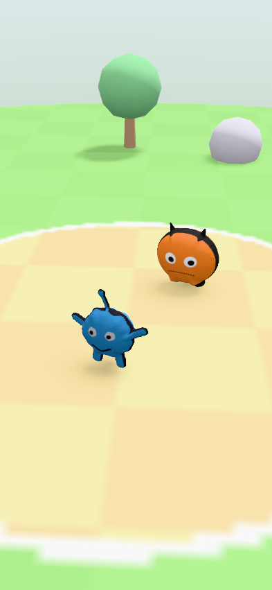
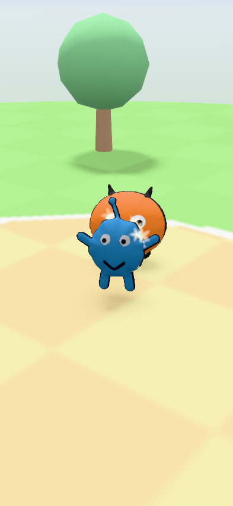
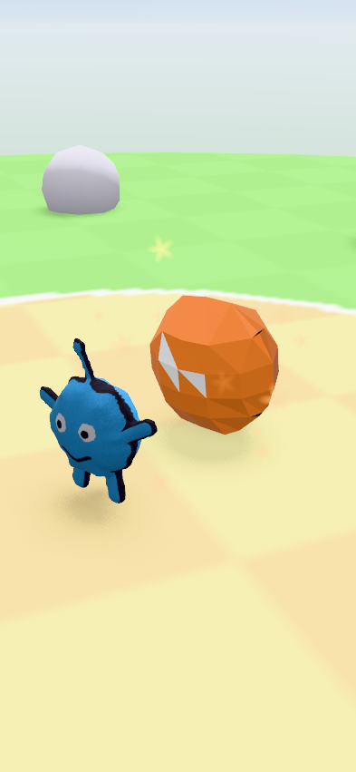
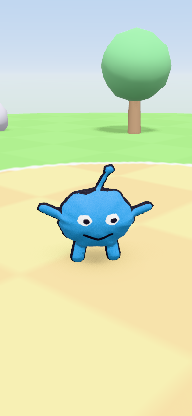

# v2.0 3D 技術スパイク（3D Tech Spike チーム）

SPEC §12（v2.0）の「キャラを 3D にする」「奥行きのある 3D バトル」を、どの技術で・どこまで・どのくらいの工数で作れるかを調べた結果です。
コードは `spike/3d` ブランチの `app/lib/features/spike3d/`（テストは `app/test/features/spike3d/`）にあります。消すときはこのフォルダと、§9 に書いた数か所の小さな変更を戻すだけです。

> **結論**: **Flutter のまま、3D は `flutter_scene`（Flutter GPU / Impeller）で描く**（案 A）。リリースは **梅 → 竹 の順に積み上げる**（同じエンジン・同じコードの上に機能を足すので、作り直しが出ない）。松（Unity / Godot で全面作り直し）は今は選ばない。

---

## 0. 松・竹・梅（PM 向けの比較表）

運用費は infra チームの試算（`docs/V2_INFRA.md` §4.5、spike/infra ブランチ）、バトルの規則はゲーム設計チーム（`docs/GAME_DESIGN_V2.md`、spike/design ブランチ）とそろえた。工数はクライアント側だけ（サーバー・クラウド生成は infra の見積もり）。

| | **梅（basic）** — Flutter ＋ 端末内「ぷっくり 3D」 | **竹（standard）★推奨のゴール** — Flutter ＋ 本格 3D（クラウド 3D は保護者の許可制） | **松（premium）** — ゲームエンジン（Unity）で全面作り直し |
|---|---|---|---|
| 子どもに見えるもの | 自分の絵が**ぬいぐるみのように膨らんだ立体**になる（表は絵そのもの、裏は少し暗い鏡像）。ぴょんぴょん跳ねて近づく・回り込む・下がる。草原と空のステージ、やわらかい影、木や岩、攻撃のたびにカメラが回り込み、当たると星がはじけて画面がゆれる、ダメージ数字。しょぼキャラは**カクカクの単色ローポリ**。技の演出はテンプレート 10 種 × 共通の簡単なエフェクト。Android 9 以下（Impeller なし）は 2D バトル（§3） | 梅に加えて、Lv10 のごほうび（と隠し要素の Lv50）で**クラウドの画像→3D AI が作った本格フィギュア**になる（同じ 3 本骨の手続き型アニメで歩く・殴る・倒れる）。テンプレート 10 種 × グー/チョキ/パーごとの演出（軌跡・光の帯・粒子・画面効果）、ステージ数種、ひっさつ技のカメラ演出、ずかんの 3D ビューア、AR も同じモデル | 竹と同等の見た目＋家庭用ゲーム機寄りの表現（物理、ポストエフェクト、自動リグの豊富なモーション）。ただし同じ予算なら**最初の 1 年は竹より見た目が劣る可能性が高い**（UI・保護者機能の作り直しに工数を取られる） |
| 技術 | `flutter_scene` 0.24（Flutter GPU / Impeller）、端末内 inflate（本スパイクで実装・テスト済み） | 梅と同じエンジン。クラウド GLB も同じ `Node.fromGlbBytes` で読み、端末で同じリグを付け直す（§4.2） | Unity 6（C#）、glTFast、Google Mobile Ads Unity plugin、Firebase Unity SDK、AR Foundation |
| Android / iOS | ○ / ○（同じ Dart コード、iOS は Metal。`FLTEnableFlutterGPU` を Info.plist に追加済み）。**Android 7〜9 は 2D にフォールバック**するか minSdk 29 へ | ○ / ○（梅と同じ） | ○ / ○ |
| v1 の再利用 | **ほぼ全部**（UI 20 画面、保護者ゲート、絵の解析、NG フィルタ、Firebase、広告、動画、カード印刷、AR、テスト 700 件超）＋サーバー全部 | ほぼ全部 | **サーバー側だけ**（Functions・Firestore・Claude の審査・TS エンジン・ポリシーサイト・ストア素材）。Dart の画面・解析・テストは C# に移植。v3 バトル規則は設計チームのゴールデンベクトルで C# 移植を検証できる |
| 工数（AI エージェント込み、エンジニア週） | **約 13 週** | 梅＋**約 10 週 = 約 23 週** | **約 60〜80 週** |
| 月額の運用費（infra §4.5、1k DAU / 10k DAU） | **低: 約 $40〜85 / $175〜225**（クラウド 3D は無しか Lv50 だけ） | **中: 約 $140〜170 / $550〜600**（クラウド 3D は自社 GPU の TRELLIS.2、Lv10 のごほうびで上限付き） | **高: 約 $530 / $3,850**（ほぼ全キャラを自動リグ付きで生成。Tripo のリグを使うと約 $5,150 / $51,000）＋Unity の有料ライセンス（ビルド用。売上・資金 20 万ドル超なら Pro 1 席 約 $2,310/年） |
| 広告収入とのバランス（infra §4.3 の中央値 $32 / $315） | 10k DAU でほぼ釣り合う | 月 約 −$120 / −$250（予算で上限） | 大きな赤字。課金の再開などが前提 |
| 主なリスク | 権限の追加なし、**新しい .so なし（16 KB OK）**、APK +3.0 MB（§6）。低価格端末の発熱（30 fps 上限・低画質で対処）。`flutter_scene` は 1.0 前。**カメラはふだん自分のキャラの背中側から見る**ので、背中の見た目の作り込みが必要（§4.4） | 梅＋クラウドモデルのポリゴン数・テクスチャ量のばらつき（取り込み時に正規化）、メモリ、生成の待ち時間 | **この環境・普通の CI では Unity をビルドできない**（Personal は手動認証不可・コンテナ内認証に既知の問題）→ AI エージェントの速度が大きく落ちる。全画面と保護者機能の再審査。Unity の自動収集（Analytics など）を切る確認。APK +20〜30 MB |
| 共通の注意（全案） | iOS のキッズカテゴリでは AdMob が審査で却下されるおそれ → **広告なしの iOS ビルドを用意**（infra §3.7）。iOS のビルドには macOS（CI の macOS ランナー）が必要 | 同左 | 同左 |
| ヘッドレスのビルドとテスト（この環境） | ◎ ビルド・単体テストに加え、**GPU 描画テスト（SwiftShader）とウィジェットテスト**まで回る | ◎ 同左 | ✕（Unity）。Godot ならエクスポートは可、描画テストは不可 |
| SPEC §12 の達成度 | 12.2: 入力 2 通り ◎（v1 流用＋お絵かきツール）／端末内 3D ◎／クラウド 3D ✕〜△（Lv50 の作り直しだけ入れる案あり）／しょぼキャラ ◎／Lv50 で本格モデル △／見た目に合った能力 ◎。12.3 ◎（設計チームの v3 エンジン）。12.4: 奥行きのある 3D・自動移動・動くカメラ ◎（演出は控えめ）／ATB・5 秒・おまかせ ◎（さきどり実装済み）／オンラインはサーバー正 ◎。12.5 ◎ | すべて ◎ | すべて ◎（ただし v1 機能の作り直しが終わるまで出せない） |

**推奨**: 竹をゴールにして、**梅を v2.0 として先に出す**（同じエンジン・同じコードの上に竹の機能を足すだけなので、捨てる作業がない）。梅の約 13 週のうち、最初の 2〜3 週で実機の性能確認（§8）をして、`flutter_scene` を続けるか予備案（§3.4）に切り替えるかを決める。

補足: Godot 4.6（案 D）は「ヘッドレスでビルドできる」点は Unity より良いが、AdMob・Firebase（App Check を含む）・カメラ・ARCore がコミュニティ製プラグインか自作になり、Families 向けアプリで依存するには保守リスクが高いので、松の候補としても Unity より下に置いた（§2.1）。
「竹を Filament（SceneView）で作る」案は、iOS 側を別に実装する必要がある（SceneView の iOS 版は RealityKit で Alpha）ため、`flutter_scene` が使えなかったときの**予備案**とした（§3.4）。

---

## 1. 調べたこと（質問への答え）

1. **描画エンジン**: `flutter_scene`（Flutter GPU）を採用。比較は §2、根拠は §3。
2. **端末内 inflate**: 純 Dart で実装済み。512px の切り抜き → リグとアニメーション付き GLB まで **約 0.17〜0.22 秒**（デスクトップ JIT）。Khronos glTF validator で **errors 0 / warnings 0**。詳細 §4。
3. **バトルのプロトタイプ**: 2 体の inflate キャラ、地面・やわらかい影・空・背景の木と岩、自動移動（近づく・回り込む・下がる）、動くカメラ、ヒット演出、Flutter の UI（ATB ゲージ 2 本と技ボタン 4 つ、ダメージ数字、おまかせ）。デバッグ用ルート `/debug/3d`。**ヘッドレスで実際に描画した画像**を `docs/v2_3d/` に置いた。§5。
4. **製品化の工数と実機でしか分からないリスク**: §7・§8。

---

## 2. エンジン比較（2026-10 時点で調査）

評価: ◎ とても良い ○ 良い △ 問題あり ✕ 不可

| 候補 | 成熟度・保守 | 低〜中価格 Android の性能 | APK 増分 | GLB・スキン・モーフ | パーティクル・演出 | iOS | 16 KB | Flutter UI との重ね合わせ | テストしやすさ（この環境） |
|---|---|---|---|---|---|---|---|---|---|
| **A1. `flutter_scene` 0.24.3（Flutter GPU）** | △〜○ 1.0 前（minor で破壊的変更あり）。Flutter 3.47 **stable** で動く（3.47 が必要な Flutter GPU を含む最初の stable）。作者は Flutter GPU を作っている人（個人の verified publisher `bdero.dev`）。リリースが速く、Galaxy A16 / Mali-G57 など**低価格端末向けの修正**が changelog に並ぶ | ○ Impeller（Vulkan、無い端末は GLES）。品質ティアと adaptive（フレームが遅れると描画解像度を下げる）あり。**Android 9 以下は Impeller 自体が無効なので使えない** | **小**（Dart コード＋シェーダ。新しい .so なし。§6 で実測） | ◎ 実行時 GLB 読み込み（`Node.fromGlbBytes`）、スキン、モーフ、アニメのブレンド | ◎ CPU パーティクル、トレイル、影（PCSS・カスケード）、フォグ、ブルーム、SSAO など | ◎ 同じコード（Metal） | ◎ 新しいネイティブライブラリなし | ◎ **同じウィジェットツリー**で描くので、ゲージやボタンを普通の Widget で重ねるだけ。3D 座標→画面座標も 1 行（ダメージ数字に使用） | ◎ **`flutter test --enable-impeller --enable-flutter-gpu` で実際に描画できる**（SwiftShader）。画面のウィジェットテストも GPU 込みで通る |
| A2. SceneView（Filament）を既存の Kotlin PlatformView で流用 | ○ Filament は Google 製で成熟、SceneView 本体も活発（AR で採用済み 4.34.0。compileSdk 37 問題あり） | ◎ Filament は GLES3/Vulkan のモバイル向けに最適化 | **0**（AR ですでに同梱） | ◎ glTF・スキン・モーフ | ○ Filament 自体にパーティクル系なし（自作） | △ SceneView の iOS 版は **RealityKit（Alpha）**。Filament を iOS で使うなら自前でバインディング → **バトルを 2 回実装** | ◎ 確認済み（AR） | ○ TLHC の上に重ねられる（AR で実績）。ただしバトルの毎フレームの状態をチャンネル越しに送る必要がある | △ JVM 単体テストのみ。描画の確認は実機が必要 |
| A3. `thermion`（Filament の Flutter バインディング） | △ 最終リリース 0.3.2（2025-07）、Filament 1.56 系 | ◎（Filament） | 中（Filament の .so を追加。AR と二重） | ◎ | △ | ○ | 要確認（Filament のバージョンが古い） | ○（Texture） | △ |
| A4. `three_js` / `three_dart`（three.js の Dart 移植） | ✕〜△ `three_dart` は放置。後継の `three_js` 0.2.x は個人プロジェクト、性能データなし | △ ANGLE 経由 | 中 | ○ | △ | ○ | 不明 | ○ | △ |
| A5. WebView ＋ three.js | ○ three.js 自体は非常に成熟 | △ Android WebView の WebGL は端末差が大きい。メモリも重い | 小（JS アセット） | ◎ | ◎ | ○ WKWebView | ◎ | △ PlatformView。JS ブリッジ越しの同期 | ○ ブラウザで確認できる |
| B. Flutter ＋ Unity 埋め込み（`flutter_unity_widget`） | ✕ **`flutter_unity_widget` は discontinued**（後継 `gameframework` 0.0.3、Unity 2022.3/2023.1 のみ記載、Unity 6 の記載なし）。Android では「OpenGL3 にしないと固まる」など既知の問題 | ○ | **大**（Unity ランタイム。空の Unity 6 arm64 で約 32 MB） | ◎ | ◎ | ○ | Unity 側は対応済み、ブリッジは不明 | △ PlatformView、ライフサイクルの問題が報告されている | ✕ Unity エディタとライセンスが必要（下記） |
| C. 全部 Unity で作り直し | ◎ エンジンは成熟。Runtime Fee は 2024-09 に撤回、Personal は売上・資金 20 万ドルまで無料・スプラッシュ非表示可 | ◎ | 大（+20〜30 MB） | ◎ | ◎ | ◎ | ◎（Unity 2021/2022/6 が対応） | —（全部 Unity の UI） | ✕ **Personal は手動ライセンス認証ができず、Docker 内の認証にも既知の問題** → この sandbox / 普通の CI ではビルド不可（Pro のシリアル or Unity Build Automation が必要） |
| D. 全部 Godot 4.6 で作り直し | ○ エンジン自体は活発（4.6.3 をこの環境でダウンロードして `--headless` 起動を確認）。**AdMob（Poing Studios）・Firebase（GodotNuts など）はコミュニティ製**。Android のカメラ（CameraServer）は 4.5 で対応と書かれているが実績報告が少ない。16 KB 対応は 4.5 以降 | ○ Mobile レンダラ（Vulkan）/ Compatibility（GLES3） | 中〜大 | ○ | ○ | ○ | △ 4.5 以降。古いテンプレートは NG | — | ○ ヘッドレスでエクスポートできる（テンプレート 1.26 GB）。ただし描画テストには GPU/Mesa が必要 |

出典（すべて 2026-10-10〜11 に確認）:
[flutter_scene（pub.dev）](https://pub.dev/packages/flutter_scene)・[changelog](https://pub.dev/packages/flutter_scene/changelog)・[0.23 ドキュメント](https://pub.dev/documentation/flutter_scene/0.23.0/)、
[Impeller（docs.flutter.dev）](https://docs.flutter.dev/perf/impeller)（Android API 29 以上で既定、それ未満は従来の描画）、
[SceneView（GitHub）](https://github.com/sceneview/sceneview)（Android Stable / iOS は RealityKit で Alpha）、
[flutter_sceneview](https://pub.dev/packages/flutter_sceneview)、
[thermion](https://docs.page/nmfisher/flutter_filament)、
[three_js](https://pub.dev/packages/three_js)、
[flutter_unity_widget（discontinued）](https://pub.dev/packages/flutter_unity_widget)・[gameframework](https://pub.dev/packages/gameframework)・[flutter_unity_widget_2](https://pub.dev/packages/flutter_unity_widget_2)、
[Unity 料金の変更](https://unity.com/products/pricing-updates)・[Runtime Fee 撤回](https://www.notebookcheck.net/Unity-cancels-Runtime-Fee-before-controversial-pricing-structure-even-goes-into-effect-in-Unity-6.887828.0.html)・[空の Unity 6 APK のサイズ](https://discussions.unity.com/t/libil2cpp-so-is-too-big/1603857)・[手動認証は Personal 不可](https://docs.unity.cn/Manual/ManualActivationCmdWin.html)・[Docker 内の認証問題](https://issuetracker.unity3d.com/issues/cannot-activate-license-within-a-docker-container)・[GameCI の Personal 認証](https://github.com/game-ci/unity-orb/issues/74)、
[Google Mobile Ads Unity plugin](https://github.com/googleads/googleads-mobile-unity)・[Families 自己認証広告 SDK](https://support.google.com/googleplay/android-developer/answer/12955712)、
[Godot AdMob（Poing Studios）](https://github.com/poingstudios/godot-admob-android/releases)・[GodotFirebase](https://store.godotengine.org/asset/godotnuts/godotfirebase/)・[CameraServer 4.5](https://docs.godotengine.org/en/4.5/classes/class_cameraserver.html)・[Godot と 16 KB](https://forum.godotengine.org/t/godot-and-google-play-policy-warning-about-16-kb-memory-page-size/120934)、
[Android の 16 KB ページ](https://developer.android.com/guide/practices/page-sizes)。

### 2.1 アーキテクチャ単位の比較（A〜D）

| | A. Flutter ＋ 3D を中に | B. Flutter ＋ Unity 埋め込み | C. 全部 Unity | D. 全部 Godot |
|---|---|---|---|---|
| v1 の再利用 | Dart 全部（UI、保護者、解析、Firebase、広告、動画、カード、AR、テスト）＋サーバー全部 | Dart 全部＋サーバー。バトルだけ C# | サーバー、ポリシーサイト、ストア素材、Claude 審査、TS バトルエンジン（サーバー）。**絵の解析（Dart）・NG フィルタ・画面・テストは C# に移植** | C と同じ（GDScript/C# に移植） |
| 作り直しの工数 | 0（3D 部分のみ） | 埋め込みの統合 4〜6 週＋バトル | 45〜60 週 | 50〜65 週（プラグインの自作・保守を含む） |
| Families 向けのリスク | v1 と同じ構成のまま（審査済みの権限・SDK 設定を維持） | Unity ランタイムが増える（Unity Analytics などを無効化する確認が必要） | 広告・Firebase は公式 SDK があるので可能。ただし Unity の自動収集（Analytics・Unity Ads）を確実に切る確認と、全画面の再審査 | 広告・Firebase がコミュニティ製で、子ども向け設定（tagForChildDirectedTreatment など）の対応を自分で確認・保守する必要 |
| iOS | 同じコード | 両 OS で Unity のビルドとブリッジ | ○ | ○ |
| AI エージェントの開発速度（この sandbox） | ◎ ビルド・単体テスト・**GPU 描画テスト**まで回る | ✕ Unity 部分はビルドできない | ✕ ビルドできない | ○ ヘッドレスでエクスポートできる。描画確認は不可 |

---

## 3. 決定と理由

**A1: `flutter_scene` を採用**（竹まで同じエンジンで行く）。

1. **Flutter の UI と同じ描画パス**: SceneView は普通のウィジェットなので、ATB ゲージ・技ボタン・ダメージ数字を `Stack` で重ねるだけ。PlatformView の合成コストやタッチの取り合い、ライフサイクル（AR で苦労した部分）が無い。3D の位置を画面座標に変える API もある（ダメージ数字で使用）。
2. **Android と iOS が同じ Dart コード**: SceneView 流用案は iOS で別実装になる。Unity/Godot は v1 の作り直しが必要。
3. **必要な機能がそろっている**: 実行時の GLB 読み込み・スキン・モーフ・ブレンド・パーティクル・影・空・フォグ（§2）。本スパイクのバトルは**エンジンに手を入れずに**作れた。
4. **テストできる**: `flutter test --enable-impeller --enable-flutter-gpu` でバトルを実際に描画して PNG に保存できた（§5）。AI エージェント中心の開発ではこれが一番効く。
5. **リリースへの影響が小さい**: 新しい権限なし、新しい .so なし（16 KB の問題が増えない）、APK の増分が小さい（§6）。

受け入れるリスクと対策:
- **1.0 前**: バージョンを固定（`^0.24.3` → 製品化時は exact pin）し、アップデートはスパイク用のレンダーテストを通してから入れる。描画は `BattleStage`（約 300 行）に閉じ込めてあり、ゲームのロジック（`AtbBattle`・`BattleDirector`）はエンジンに依存しない。
- **Impeller が無い端末（Android 9 以下、minSdk 24〜28）では描けない**: `flutterGpuAvailable()` で判定して 2D バトル（v1 のバトル画面を ATB 化したもの）にフォールバック。もしくは v2.0 で minSdk を 29 に上げる（PM 判断、§9）。
- **Impeller の GLES フォールバック端末**（Vulkan 非対応の Android 10+）: changelog に GLES の修正が多く入っているので動く想定だが、実機確認が必須（§8）。

### 3.4 予備案（flutter_scene が実機で使えなかった場合）

`BattleDirector`（Dart）はそのままにして、`BattleStage.apply` に当たる部分だけを Android は SceneView（Filament、AR と同じ依存）、iOS は SceneKit/RealityKit で書き直す。毎フレームの状態（2 体の位置・向き・クリップ、カメラ、エフェクト）を 1 つのバイト列にまとめてチャンネルで送る。追加工数は 1 プラットフォームあたり 6〜8 週。

---

## 4. 端末内 inflate（`features/spike3d/inflate/`）

### 4.1 手順（純 Dart、決定的）

1. 切り抜き PNG（透過、512px 以下）を不透明部分で切り詰め、面積平均で最長辺 128px の作業マスクにする。いちばん大きい塊だけ残し、小さな穴は埋める。
2. 正確なユークリッド距離変換（AR の `squaredDistanceTransform` を再利用）で、輪郭までの符号付き距離を作る。
3. 各点を覆う**いちばん大きい内接円の半径 R**（距離の尾根から円を塗って求める）を使い、高さを `h = 0.7·√(d(2R−d))` とする。腕やアンテナは細い筒、胴体はドームになる（全体の最大距離を使うと手足が太りすぎる）。高さを 2 回なめらかにする。
4. **マーチングスクエアの「塗り」**: 格子（最長辺 56 マス）の内側の角に高さを、輪郭との交点に高さ 0 を置く。表（+h）と裏（−h）は輪郭の頂点を共有するので、**継ぎ目のない閉じた立体**になる（テストで全辺が 2 枚の三角形に共有され、向きがそろっていることを確認）。
5. 法線は共有頂点の面積加重平均。テクスチャは絵そのもの（透明部分に色をにじませて縁の黒ずみを防ぐ）。裏は頂点カラーで 55% の明るさ、UV は同じなので**裏から見ると鏡像**。
6. **しょぼキャラ（simplified）**: 距離場をぼかして形を丸め、全体最大半径のドーム、格子 9 マス（64 三角形）、面ごとに分けたフラットシェーディング、色は絵から k-means で取った 3 色。テクスチャなし。

### 4.2 リグとアニメーション（`procedural_rig.dart`）

- 骨 3 本（足元 `rig_root` → `rig_spine`（高さ 42%）→ `rig_head`（72%））。重みは高さで決め、1 頂点あたり最大 2 本。
- glTF のスキンアニメーション 5 本（30 fps、LINEAR）: `idle`（1.2 秒ループ、上下とゆらゆら）、`hop`（ため→ジャンプで伸び→着地でつぶれる）、`attack`（のけぞり→前に突っ込みながら前傾）、`hit`（後ろにはじかれて減衰振動）、`faint`（ふらふら→後ろに倒れて止まる）。つぶれ・伸びは体積を保つ（sx = 1/√sy）。
- どの絵にも同じクリップが使える。**クラウドの本格モデル（竹）にも、端末で同じリグを付け直す**: 頂点の高さから重みを計算する（`skinWeights`）だけなので、人型でない子どもの絵でも壊れない。infra チームの「自動リグに頼らず、全モデルを手続き型アニメで動かす」方針（V2_INFRA §1.4）と同じ考え方で、クラウド側にリグの費用がかからない。

### 4.3 背中の見た目（製品化で必ず直すこと）

縦画面のカメラはふだんプレイヤーの斜め後ろから見るので、子どもは**自分のキャラの背中を一番長く見る**。今の背中は「絵の鏡像を 55 % の明るさ」にしたもので、目や口が裏返って透けて見える（`docs/v2_3d/battle_0.5s.png` の青いキャラ）。製品では、背中用のテクスチャ（顔などの細かい線を消して主な色で塗った版）を 2 枚目の素材として持たせる。1 週間ほど（§7 に含めた）。

### 4.4 検証と計測

- 単体テスト `inflate_test.dart`: 閉じていること・外向き（符号付き体積 > 0）、足元が原点・高さ 1 m・前後対称、細い部分が細いこと、決定的、空の画像の拒否、しょぼキャラが 400 三角形未満・色 6 種以下、GLB の構造（`GlbDocument.validate()`）、スキンの重みの合計が 1、クォータニオンが単位長、idle のループのつながり。
- **Khronos glTF validator 2.0.0-dev.3.10**（AR チームの設定を再利用、`app/test/features/spike3d/gltf_validate.sh`）: 4 種類（普通・512px・しょぼ 2 種）すべて **errors 0 / warnings 0**（info の `IMAGE_NPOT_DIMENSIONS` のみ。GLES3 なので問題なし）。
- **生成時間（512px の切り抜き、デスクトップ JIT、x86）**: 合計 **約 170〜220 ms**（PNG デコード 32〜37 ms、メッシュ 113〜142 ms、リグ 1 ms 未満、GLB エンコード 24〜41 ms）。**2,514 頂点 / 5,024 三角形、342 KiB**（大半はテクスチャ PNG）。しょぼキャラは **約 65 ms、64 三角形、26 KiB**。端末では Isolate で実行（`buildInflatedGlbInBackground`）。ミドル端末の AOT では同程度〜2 倍と見込む（要実機計測、§8）。

---

## 5. バトルのプロトタイプ（`features/spike3d/battle/`）

```
Battle3DScreen（Flutter）
 ├─ SceneView（flutter_scene）……… BattleStage: 空・太陽（影）・地面・木と岩・2 体の GLB・ヒット演出
 │     onTick(dt) ──▶ AtbBattle.tick ──イベント──▶ BattleDirector.handle/update ──▶ BattleStage.apply
 │     cameraBuilder ◀── BattleDirector.camera
 └─ Stack の上に普通の Widget: HP・ATB ゲージ ×2、技ボタン ×4、のこり秒、おまかせ、ダメージ数字（3D→画面座標）
```

- `AtbBattle`（プロトタイプ。本物の数値はゲーム設計チーム）: ゲージは AGI の比でたまり、相手が選んでいる間も止まらない。満タンになったら技を待ち、5 秒で「おまかせ」。CPU は 0.6 秒考えて決める。行動は 1 つずつ（演出の時間だけロック）。ダメージは行動の開始時に決まり、**画面の HP は当たった瞬間に減らす**（演出と数字のずれを防ぐ）。オンラインではこの部分をサーバーが持ち、クライアントはイベントを受け取って同じ Director に流すだけ。
- `BattleDirector`（純 Dart、seed で決定的、エンジン非依存）: 近づく・回り込む（左右）・下がる・待つ を 1〜2.5 秒ごとに選び、ぴょんぴょん移動（`hop` を繰り返す）。リングから出ない、重ならない。攻撃は 相手まで突進 → `attack` → 0.3 秒で命中（星のパーティクル＋光、画面のゆれ、相手は `hit` でノックバック）→ 下がる。KO で負けた側は `faint`、勝った側はカメラのほうを向いて跳ね、カメラが勝者の周りを回る。
- **縦向きの画面用カメラ**: 横からだと 2 体が横に並んで画面からはみ出すので、プレイヤーの斜め後ろ上（約 65°、見下ろし約 29°、縦の画角 52°）から見る。プレイヤーが左下・相手が右上に並ぶ。攻撃のときは攻撃する側の背中側へ回り込んで寄る。テストで「戦闘中は 2 体とも体の幅まで画面内（はみ出し 1% 未満）」「プレイヤーが左側（95% 以上）」を確認。
- ヘッドレス描画（`battle_render_test.dart`、SwiftShader）: 下の画像はテストが描いたもの。

| 開始 0.5 秒 | 攻撃の命中（3.6 秒） | 相手がしょぼキャラ（9 秒） | 勝利（24 秒） |
|---|---|---|---|
|  |  |  |  |

- **ゲーム設計 v3 とのつなぎ方**（`GAME_DESIGN_V2.md` §6）: 本物のエンジンは 10 Hz の整数 tick で、イベント（tick 付き）を出す。オンラインではサーバーのイベントを 150〜250 ms 遅らせて再生する。`BattleDirector` はイベントを受けて演出を組み立てるだけなので、`AtbBattle`（プロトタイプ）を v3 エンジン（端末）やサーバーのイベント列に差し替えても描画側は変わらない。設計チームの要件「**さきどり**（ゲージがたまる間に次の技をタップしておくと、満タンの瞬間に出る）」は実装・テスト済み。設計の未決定事項 Q6（演出中も時間を止めない）に合わせ、製品では演出が遅れたとき（行動が 2 つ以上たまったとき）に突進を省いた短い版の攻撃にして、遅れを 1 秒以内に保つ。技のテンプレート 10 種（strike / combo / blast / barrage / heal / power_up / weaken / poison / paralyze / barrier）それぞれに演出が要る（§7）。
- ウィジェットテスト `battle_screen_test.dart`: GPU ありでは「読み込み → ゲージが満タンで『えらんでね』→ 技をタップ → 『まってね』」まで通る。GPU なし（普通の `flutter test`、Skia 端末）ではフォールバックの説明が出る。
- デバッグ入口: `/debug/3d`（debug ビルドだけ。セットアップ前でも開ける）。`flutter run --dart-define=INITIAL_ROUTE=/debug/3d` で直接起動。サンプル・ずかんのキャラ・しょぼ相手・低画質を選べる。ビューア（回転台、クリップの切り替え、頂点数・生成時間の表示）もある。

### 5.1 フレームの予算（60 fps = 16.7 ms、低ティアは 30 fps = 33 ms）

| 処理 | どこ | 見積もり / 実測 |
|---|---|---|
| ATB・Director・apply・`scene.update`（アニメ 2 体、パーティクル） | UI スレッド（Dart） | **実測 約 0.3 ms/フレーム**（289〜301 µs、デスクトップ JIT、`battle_render_test.dart`）。端末の AOT で 1〜2 ms 想定 |
| 描画コマンドの組み立て（約 40 ドローコール: キャラ 2、影、地面、木と岩 18、エフェクト） | UI スレッド | 2〜4 ms 想定 |
| GPU: スキンメッシュ 2 体（計 約 10k 三角形）、カスケード影 2 段、空、MSAA/FXAA | GPU | ミドル端末 5〜8 ms 想定。低ティアは影と小物なし・描画解像度 0.75・30 fps 上限（`SceneView.maxFrameRate`） |
| Flutter の UI（ゲージ・ボタン） | UI/raster | 1 ms 未満 |

SwiftShader（CPU ラスタライザ）では 393×851 の 1 フレームに約 70〜100 ms かかるが、これは端末の性能とは関係ない（GPU の速さは実機で測る、§8）。

---

## 6. ビルドとサイズ（この環境、Flutter 3.47.7、AGP 9.1）

| | main（ベースライン） | spike/3d |
|---|---|---|
| `flutter analyze` | — | **No issues found** |
| `flutter test`（全体、`--concurrency=2`） | — | **709 件 pass**（GPU が要る 3 件は skip） |
| `flutter test --enable-impeller --enable-flutter-gpu test/features/spike3d` | — | **20 件 pass**（実際の描画を含む。初回だけ build hook のシェーダコンパイルで約 4.5 分） |
| Khronos glTF validator（`gltf_validate.sh`） | — | 4 ファイルすべて errors 0 / warnings 0 |
| `flutter build apk --debug` | — | ✓ 201 秒、240.8 MB（全 ABI） |
| `flutter build appbundle --release` → `scripts/check_release.sh` | — | ✓ 401 秒、100.6 MB。**check_release: passed**（警告 2 件はテスト用 AdMob ID と debug 鍵で、main と同じ）。権限の追加なし |
| `flutter build apk --release --split-per-abi`（arm64） | 45.93 MB（45,933,779 B） | **48.97 MB（48,973,793 B）＝ +3.04 MB** |
| 16 KB | — | `zipalign -c -P 16` OK。arm64 の .so はすべて LOAD の align ≥ 0x4000（**新しい .so は無い**。一覧は main と同じ） |

APK の増分の内訳（圧縮後 約 3.0 MB）: `flutter_scene` のシェーダバンドル 2 つ（展開時 9.5 MB → 圧縮 約 2.1 MB）、パッケージ同梱のサンプル環境マップ `royal_esplanade.png` 0.8 MB（使っていないので製品では除外を検討）、SMAA・LTC・DFG の表 0.3 MB。**Dart のコードは増えていない**（スパイクの画面は debug ビルドだけのルートなので release では tree-shake される）。製品で画面をつなぐと、Dart コード分として +0.3〜0.6 MB を見込む。

---

## 7. 製品化の工数（エンジニア週、AI エージェント併用）

| 項目 | 梅 | 竹で追加 |
|---|---|---|
| inflate の品質（本物の子どもの絵・お絵かきツールの出力・複数パーツ・穴・極端に細長い絵）、背中用テクスチャ（§4.3）、`imageHash` ごとのキャッシュ | 3 | — |
| バトル描画の作り込み（ステージ 3 種、技テンプレート 10 種の基本演出、カメラ演出、勝敗演出） | 4 | — |
| v3 バトルエンジン（設計チーム）とのつなぎ込み、オンライン（サーバーのイベント再生・150〜250 ms の遅延・演出の追いつき） | 2 | — |
| 2D フォールバック（Impeller なしの端末）か minSdk 29 化の対応 | 1.5 | — |
| 品質ティアの自動選択（GPU・メモリ）、発熱・電池の対策、実機の性能 QA（下限〜中位 6 機種、iOS 2 機種） | 2 | +1 |
| ずかんの 3D ビューア、AR で同じ GLB を使う（AR は SceneView のまま、立て札の代わりに inflate モデル） | 0.5 | — |
| クラウド 3D モデルの取り込み（GLB の検証、ポリゴン 20k・テクスチャ 1024px への正規化、端末で同じリグを付け直す、失敗時は inflate に戻す、ダウンロードとキャッシュ） | — | 3 |
| グー/チョキ/パー × テンプレートの演出（軌跡・光の帯・粒子）、ひっさつ技のカメラ、ポストエフェクト | — | 3 |
| クリップの追加（歩く・ガード・ひっさつ・喜ぶ など 4〜6 本） | — | 2 |
| Lv50 の作り直し演出、メモリ予算（クラウドモデル 2 体＋エフェクト） | — | 1 |
| **合計** | **約 13 週** | **＋約 10 週（計 約 23 週）** |

松（Unity）: 画面とフロー 20 画面 12〜15、保護者機能・同意・データ削除 4〜5、絵の解析とお絵かきツール 8〜10、NG フィルタ・名前 2、Firebase・オンライン 5〜6、広告・課金 3〜4、動画書き出し（ネイティブプラグイン）3〜4、カード印刷 2〜3、AR（AR Foundation）2〜3、テストと CI（ライセンスを含む）4〜6、3D バトル 15〜20 → **約 60〜80 週**。

---

## 8. 実機でしか確かめられないリスク（QA チェックリスト）

- [ ] **Impeller GLES フォールバック端末**（Vulkan 非対応の Android 10+）で `flutter_scene` が正しく描けるか（影・スキン・パーティクル・sRGB）。だめなら低ティア（影なし）か 2D へ
- [ ] **Android 9 以下**（Impeller なし）で `flutterGpuAvailable()` が false になり、2D に切り替わること
- [ ] 低価格端末（Galaxy A0x/A1x、Mali-G52/G57、PowerVR、RAM 3〜4 GB）で 1 戦（約 30〜60 秒）を 3 回続けたときの fps・発熱・電池。目標: 低ティアで 30 fps を維持
- [ ] 初回のシェーダ準備（`SceneView.warmUp`）にかかる時間とカクつき
- [ ] メモリ: キャラ 2 体（テクスチャ 512px ×2）＋影マップ＋環境マップで 150 MB 以内か。クラウドモデル（竹）は 1 体 20k 三角形・テクスチャ 1024px までに正規化
- [ ] 生成時間: 512px の inflate がミドル端末の Isolate で 0.5 秒以内か
- [ ] AR（SceneView、TLHC）を開いたあとにバトルを開く・その逆で、GPU リソースの競合や黒画面がないか
- [ ] Pixel 8 以降（16 KB ページ）で起動とバトル
- [ ] iOS（Metal）: 同じ画面が同じように見えること（`FLTEnableFlutterGPU` を Info.plist に追加済み）

---

## 9. ブランチに入れた変更（消す・本番化するときの目印）

- 新規: `app/lib/features/spike3d/**`、`app/test/features/spike3d/**`、`docs/V2_3D_TECH.md`、`docs/v2_3d/*.png`
- `pubspec.yaml`: `flutter_scene: ^0.24.3`、`vector_math: ^2.4.3`（flutter_scene は `vector_math.dart` の 32bit 版を使う）
- `features/ar/glb/glb_writer.dart`: `GltfComponentType.unsignedByte` と `addRawAccessor()` を追加（`JOINTS_0` と 32bit インデックス用。既存の動作は変えていない）
- `AndroidManifest.xml`: `io.flutter.embedding.android.EnableFlutterGPU = true`。`ios/Runner/Info.plist`: `FLTEnableFlutterGPU = true`
- `core/router`: debug ビルドだけ `/debug/3d` を追加、`INITIAL_ROUTE` の dart-define、`/debug` はセットアップ前のリダイレクトを通さない

### PM の判断が必要なこと

1. **minSdk を 29（Android 10）に上げるか**、Android 7〜9 向けに 2D バトルを残すか（2D を残すと +1.5 週、上げると 2D の保守が不要）。
2. 梅の時点で「本格 3D（クラウド）」を出すか、竹（v2.1）まで待つか。
3. `flutter_scene` が 1.0 前であることの受け入れ（固定バージョン＋レンダーテストで更新を管理）。
4. CI で GPU 描画テストを回すか（初回は build hook のシェーダコンパイルに約 4.5 分。以降はキャッシュ）。
